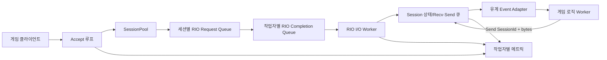
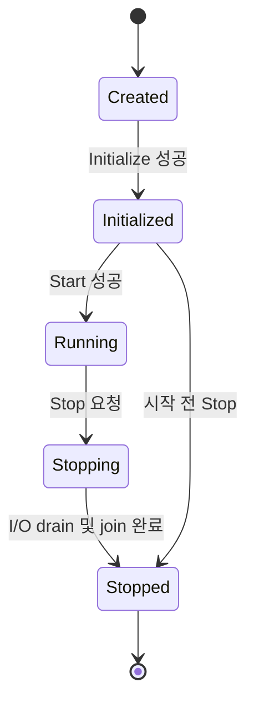
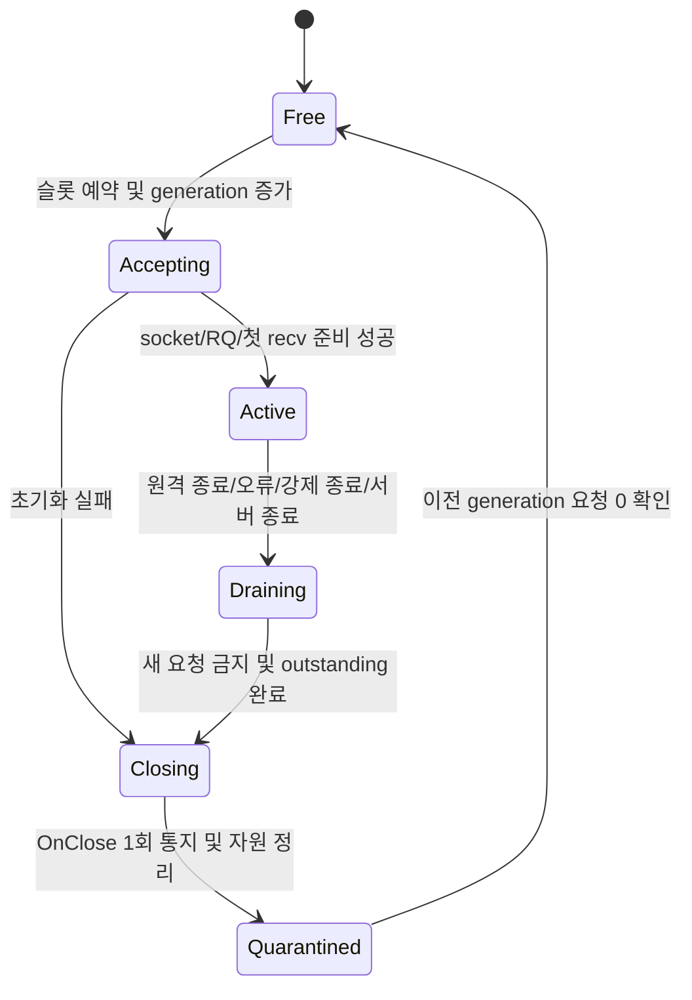

# RIONetLite 고성능·안정성 구현 계획

> 문서 상태: 구현 진행 중
>
> 대상 플랫폼: Windows x64, Visual Studio 2026, MSVC v145, `/std:c++latest`
>
> 코딩 규칙: Google C++ Style Guide와 저장소의 `.clang-format`
>
> 메모리 할당자: vcpkg manifest로 관리하는 mimalloc

## 목적

RIONetLite를 Windows Registered I/O(RIO)에 최적화된 게임 서버용 TCP 네트워크 라이브러리로 완성한다. 단순히 처리량이 높은 코드가 아니라 세션 재사용, 비동기 I/O 완료, 버퍼 수명, 과부하, 종료와 오류 상황에서도 동작이 예측 가능하고 검증 가능한 라이브러리를 목표로 한다.

또한 사용자가 라이브러리의 스레드 모델과 수명 규칙을 오해하지 않고 빠르게 적용할 수 있도록 최소 예제, 실제 게임 서버 구조 예제, 부하 생성 도구, 단계별 문서와 API 레퍼런스를 함께 제공한다. 구현 결과는 다음 조건을 만족해야 한다.

- 정상 경로뿐 아니라 부분 송수신, 원격 종료, 강제 종료, 초기화 실패, 큐 포화와 서버 종료 경로를 정의하고 검증한다.
- 네트워크 스레드가 게임 로직, DB, 파일 I/O 같은 장시간 작업에 막히지 않는 구조를 공개 예제로 제시한다.
- 세션 인덱스가 재사용되어도 이전 세대의 완료 이벤트나 송신 요청이 새 연결에 적용되지 않게 한다.
- 정상 I/O 경로에서 동적 할당과 전역 경합을 제거하거나 측정 가능한 최소 수준으로 제한한다.
- 성능 주장은 동일 장비와 동일 시나리오의 재현 가능한 벤치마크 결과로만 판단한다.
- 처음 사용하는 개발자가 README에서 시작하여 빌드, 실행, 패킷 처리, 종료, 튜닝까지 순서대로 학습할 수 있게 한다.

## 전체 태스크 리스트

- [x] [T00. 기준선 고정과 결함 재현](#t00-기준선-고정과-결함-재현)
- [x] [T01. 지원 범위와 품질 목표 확정](#t01-지원-범위와-품질-목표-확정)
- [x] [T02. 솔루션과 라이브러리 프로젝트 재구성](#t02-솔루션과-라이브러리-프로젝트-재구성)
- [x] [T03. 공개 API와 서버 수명 주기 재설계](#t03-공개-api와-서버-수명-주기-재설계)
- [x] [T04. 설정 검증과 오류 모델 정비](#t04-설정-검증과-오류-모델-정비)
- [x] [T05. Windows 및 RIO 자원의 RAII 전환](#t05-windows-및-rio-자원의-raii-전환)
- [ ] [T06. 세션 상태 머신과 세대 검증 구현](#t06-세션-상태-머신과-세대-검증-구현)
- [ ] [T07. RIO 완료 컨텍스트와 요청 수명 보장](#t07-rio-완료-컨텍스트와-요청-수명-보장)
- [ ] [T08. 결정론적 종료와 연결 해제 경로 구현](#t08-결정론적-종료와-연결-해제-경로-구현)
- [ ] [T09. 수신 버퍼와 프레이밍 계약 강화](#t09-수신-버퍼와-프레이밍-계약-강화)
- [ ] [T10. 송신 파이프라인과 백프레셔 구현](#t10-송신-파이프라인과-백프레셔-구현)
- [ ] [T11. 게임 로직 전달 큐와 이벤트 순서 보장](#t11-게임-로직-전달-큐와-이벤트-순서-보장)
- [ ] [T12. RIO 작업자, 배치와 CPU 정책 최적화](#t12-rio-작업자-배치와-cpu-정책-최적화)
- [ ] [T13. 메모리 레이아웃과 mimalloc 정책 최적화](#t13-메모리-레이아웃과-mimalloc-정책-최적화)
- [ ] [T14. 구조화 로그, 메트릭과 진단 정보 추가](#t14-구조화-로그-메트릭과-진단-정보-추가)
- [ ] [T15. 단위 테스트 기반 구축](#t15-단위-테스트-기반-구축)
- [ ] [T16. 루프백 통합 테스트 구축](#t16-루프백-통합-테스트-구축)
- [ ] [T17. 장애 주입, 스트레스와 장시간 테스트 구축](#t17-장애-주입-스트레스와-장시간-테스트-구축)
- [ ] [T18. 성능 벤치마크와 회귀 기준 구축](#t18-성능-벤치마크와-회귀-기준-구축)
- [ ] [T19. 최소 Echo 예제 재작성](#t19-최소-echo-예제-재작성)
- [ ] [T20. 게임 서버형 Chat 예제 재작성](#t20-게임-서버형-chat-예제-재작성)
- [ ] [T21. 부하 및 오류 시나리오 클라이언트 추가](#t21-부하-및-오류-시나리오-클라이언트-추가)
- [ ] [T22. 학습 문서와 API 레퍼런스 작성](#t22-학습-문서와-api-레퍼런스-작성)
- [ ] [T23. CI, 패키징과 릴리스 절차 구축](#t23-ci-패키징과-릴리스-절차-구축)
- [ ] [T24. 호환 계층 제거와 최종 품질 점검](#t24-호환-계층-제거와-최종-품질-점검)

## 구현 진행 기록

| 날짜 | 완료 태스크 | 결과 |
|---|---|---|
| 2026-08-26 | T00 | `docs/baseline.md`에 도구 체인, 순차 빌드 결과, 환경 특이사항과 KI-001~010을 기록했다. 성능 수치는 T18의 고정 harness가 없으므로 임의 측정값을 만들지 않고 측정 조건만 ADR로 고정했다. |
| 2026-08-26 | T01 | 지원 플랫폼, callback threading, overload, shutdown과 성능 측정 ADR 5개를 승인 상태로 추가했다. |
| 2026-08-26 | T02 | 루트 `RIONetLite.sln`, 정적 라이브러리, GoogleTest 단위/통합 프로젝트, 공통 props, root vcpkg manifest와 `tools/build.ps1`을 추가했다. 예제 프로젝트에서 `impl/` 파일 참조를 제거하고 구성별 출력 경로를 분리했다. |
| 2026-08-26 | T03 | `include/rionetlite`에 move-only `Server`, `SessionId`, `EventHandler`, lifecycle, send/close 결과 API를 추가했다. 기존 `ServerNetManager`는 신규 API를 호출하는 compatibility wrapper로 전환했다. |
| 2026-08-26 | T04 | page/size/count/관계식/CQ/등록 메모리 검증과 구조화 오류를 추가하고, 나머지가 있는 세션 분배를 구현했다. |
| 2026-08-26 | T05 | Winsock, socket, HANDLE, double mapping, RIO registered buffer와 CQ RAII를 추가하고 실제 초기화·세션·버퍼 경로에 연결했다. bind 실패 롤백, outstanding 등록 버퍼 보호와 즉시 Start/Stop 경쟁을 테스트했다. |

T06 이후에서 해결할 위험은 여전히 존재한다. 특히 세션 상태와 generation의 원자적 전이, 모든 RIO context의 outstanding 추적, completion drain을 포함한 graceful shutdown은 각각 T06~T08 범위다.

## 범위와 원칙

### 1차 릴리스 범위

- Windows x64 전용 TCP 서버 라이브러리로 한정한다.
- 전송 계층은 RIO를 사용하고, 패킷 직렬화와 게임 프로토콜 자체는 라이브러리에 포함하지 않는다.
- 기본 공개 모델은 콜백과 `SessionId`를 사용하되, 게임 로직으로 안전하게 전달하는 유계 큐 어댑터를 제공한다.
- IPv4를 우선 완성한다. IPv6, TLS, UDP, 클라이언트 라이브러리는 별도 ADR에서 필요성을 결정하기 전까지 1차 범위에 넣지 않는다.
- 예제는 최소 API 사용법과 운영에 가까운 구조를 분리한다. 최소 예제에 운영 구조를 억지로 모두 넣지 않는다.

### 변경 불가 원칙

- RIO에 등록한 메모리는 해당 메모리를 참조하는 모든 요청의 완료를 확인하기 전까지 이동, 재사용 또는 해제하지 않는다.
- 모든 완료 이벤트는 세션 인덱스와 세대를 함께 검증한다.
- 한 세션의 `Connect → Receive/Send → Close` 관찰 순서는 항상 일관되어야 한다.
- 공개 함수는 성공, 재시도 가능 실패, 과부하, 잘못된 사용, 종료 중 상태를 구분해 반환한다.
- `Start`, `Stop`, 소멸자는 예외 안전하고 반복 호출 정책이 명확해야 한다.
- 네트워크 콜백에서 사용자 코드가 오래 실행되더라도 잘못된 메모리를 참조하지 않게 하며, 권장 경로는 데이터 복사 또는 소유권 이전 후 즉시 반환하는 방식으로 한다.
- 성능 최적화는 기준선, 프로파일링 결과와 회귀 테스트 없이 병합하지 않는다.

## 완료 판정 기준

### 정확성 및 안정성

- Debug와 Release의 x64 전체 솔루션이 경고 수준 `/W4`, `/permissive-`, `/utf-8`, `/std:c++latest`로 빌드된다.
- 모든 공개 설정 조합이 시작 전에 검증되며 0으로 나누기, 정수 오버플로, 음수의 unsigned 변환이 없다.
- 패킷 분할, 병합, 잘못된 길이, 수신 버퍼 고갈, 송신 큐 포화, 부분 송신과 0바이트 완료가 자동 테스트에 포함된다.
- 같은 세션 슬롯을 빠르게 재사용하는 테스트에서 이전 세대 이벤트가 새 연결에 전달되지 않는다.
- 서버 종료 후 accept, I/O 작업자, 송신 작업자와 애플리케이션 작업자 스레드가 남지 않는다.
- 24시간 장시간 테스트에서 크래시, use-after-free, 이중 해제, 증가하는 핸들 수와 지속적인 메모리 증가가 없다.
- AddressSanitizer, Application Verifier 또는 PageHeap을 적용한 오류 시나리오 테스트가 통과한다.

### 성능

- 측정 장비, CPU 전원 정책, OS, 빌드, 커밋, 설정, 클라이언트 수, 패킷 크기와 측정 시간을 결과에 기록한다.
- 처리량, 평균/P50/P95/P99 지연, CPU 사용률, 컨텍스트 스위치, 송수신 바이트, 큐 깊이, 실패와 연결 해제 사유를 함께 기록한다.
- 정상 상태 I/O 경로의 동적 할당 횟수를 측정하며 목표는 초기화 이후 패킷당 할당 0회다. 복사가 필요한 애플리케이션 이벤트는 미리 할당한 풀 또는 명시적 유계 저장소를 사용한다.
- 기준선이 만들어진 뒤 Release 병합 기준을 처리량 5% 이상 하락 또는 P99 지연 10% 이상 악화 시 실패로 둔다. 장비 변동이 큰 CI에서는 절대 통과 기준 대신 이전 결과 대비 추세와 반복 측정의 중앙값을 사용한다.
- CPU 100%의 busy polling만으로 얻은 처리량과 CPU 절약 모드를 분리해 보고한다.

### 사용성

- 새 개발 환경에서 README만 따라 x64 Debug Echo 서버를 10분 안에 빌드하고 실행할 수 있다.
- 최소 예제는 공개 헤더만 포함하며 `impl/`을 직접 참조하지 않는다.
- 각 공개 타입과 함수에는 수명, 스레드 안전성, 콜백 실행 스레드, 반환값과 오류 조건이 문서화된다.
- Chat 예제가 네트워크와 게임 로직의 분리, 유계 큐, 패킷 검증, 정상 종료를 모두 보여준다.

## 현재 코드에서 확인한 우선 위험

| 우선순위 | 위치 | 현재 상태 | 구현 시 해결 방향 |
|---|---|---|---|
| P0 | `impl/session_manager.h` | 세션 풀 생성 반복문이 `i <= rioThreadCount`라서 계획보다 한 작업자 분량을 더 만들고 유효하지 않은 작업자 인덱스를 배정할 수 있다. | 정확한 파티셔닝 함수와 단위 테스트를 만든다. |
| P0 | accept/worker/send 클래스 | `is_run_`, 연결 상태와 네트워크 허용 상태를 여러 스레드가 비원자적으로 읽고 쓴다. | 명시적 상태 머신과 `std::atomic`, 단일 소유 작업자 규칙을 적용한다. |
| P0 | `impl/server_net_io_worker.h` | 작업자 람다가 지역 `rioQueue`를 참조 캡처하며, 작업자 내부 배열은 `delete`로 해제되고 `memset` 크기도 포인터 크기다. | CQ를 값으로 캡처하고 `std::vector<RIORESULT>` 또는 고정 버퍼를 사용한다. |
| P0 | 지연 종료 관리자 | 작업자 스레드들이 동시에 `vector::emplace_back`을 실행하며 생성 순서와 `thread_index`가 일치한다는 보장이 없다. | 시작 스레드에서 큐 수를 먼저 확정하고 인덱스로 소유하게 한다. |
| P0 | `SendImmediately` | 등록 송신 버퍼의 쓰기 위치가 완료와 독립적으로 순환하고 용량 검사가 생략되어 outstanding 요청의 메모리를 덮을 수 있다. | 예약/커밋/완료 위치가 분리된 유계 송신 큐와 요청별 범위를 구현한다. |
| P0 | 서버 종료 | CQ를 작업자 join 전에 닫고, outstanding I/O drain 보장 없이 세션 버퍼를 deregister한다. | 수락 중단, 세션 종료 요청, 완료 drain, 작업자 join, CQ/버퍼 해제 순서를 적용한다. |
| P0 | 완료 처리 | `RIORESULT.Status`를 확인하지 않고 바이트 수만 처리하며 세션 포인터와 세대를 완료마다 충분히 검증하지 않는다. | 상태 코드, 작업 종류, 세대, 요청 식별자와 잔여 바이트를 모두 검사한다. |
| P0 | 수신 처리 | 콜백이 반환한 소비 바이트가 현재 readable 크기보다 큰지 검증하지 않고, 고정 길이 recv를 빈 공간과 무관하게 게시한다. | readable/writable 불변식과 콜백 계약 위반 처리를 추가한다. |
| P0 | accept 실패 | RQ 생성 실패 전에 승인된 소켓의 소유권이 세션으로 이전되지 않아 소켓 누수가 가능하다. | 승인 직후 RAII 소켓이 소유하고 성공 시에만 세션으로 이전한다. |
| P1 | `TcpSession::OnConnect` | `socket_` 대입 전에 `setsockopt(socket_, TCP_NODELAY)`를 호출한다. | 인자로 받은 승인 소켓에 옵션을 적용하고 실패 정책을 기록한다. |
| P1 | 초기화/시작 | 중간 실패 롤백이 없고 `StartIoThreads` 실패를 호출자가 알 수 없다. | 단계별 트랜잭션 초기화와 구체적 `Result`를 반환한다. |
| P1 | 전역 로그 | 초기값이 없는 전역 함수 포인터를 호출할 수 있고 서버 인스턴스별 로거를 둘 수 없다. | no-op 기본값을 가진 인스턴스별 logger를 주입한다. |
| P1 | 링 버퍼 | 경계, 가득 참/비어 있음 구분과 overflow 검증이 불충분하고 `SendRingBuffer`는 배열에 `delete`를 사용한다. | 독립 단위 테스트가 있는 소유형 버퍼로 교체한다. |
| P1 | 예제 패킷 | raw `reinterpret_cast`, 길이·ID 검증 부족, 호스트 endian 의존, 무제한 또는 재사용 위험이 있는 메시지 저장소를 사용한다. | 안전한 decode/encode 함수와 유계 큐, 세대 검증을 예제로 제공한다. |
| P2 | 프로젝트 구조 | 라이브러리 구현이 헤더에 있고 예제 프로젝트가 내부 헤더 전체를 직접 포함한다. | 정적 라이브러리와 공개 include 경계를 만든다. |
| P2 | 소스 문서 | 과거 인코딩이 깨진 주석과 README 내용이 많아 계약을 이해하기 어렵다. | UTF-8로 정리하고 상세 문서를 `docs/`에 분리한다. |

## 목표 아키텍처



### 소유권

- `Server`가 Winsock 수명, listen socket, 작업자 집합, completion queue 집합, session pool과 logger/metrics를 소유한다.
- 각 `IoWorker`는 자신의 CQ, 결과 배치 버퍼, 지연 명령 큐와 작업자별 카운터를 단독 소유한다.
- 각 `Session`은 socket, RQ, generation, recv 저장소, send 저장소와 outstanding 요청 수를 소유한다.
- 각 `IoContext`는 작업 종류, 세션 인덱스, generation, 버퍼 offset, 요청 길이, 완료된 길이와 요청 번호를 가진다.
- accept 단계의 소켓은 RAII 임시 객체가 보유하고, 세션 활성화가 완전히 성공한 뒤에만 소유권을 이전한다.
- 애플리케이션에 전달하는 데이터는 빌린 view의 유효 범위를 콜백 호출 동안으로 제한하거나, 별도 메시지 저장소로 복사하여 명시적으로 소유하게 한다.

### 서버 수명 주기



### 세션 수명 주기



시간 지연만으로 세션 재사용 안전성을 추정하지 않는다. 이전 generation의 outstanding 요청이 0이고 close 통지가 끝난 것을 확인한 뒤 슬롯을 재사용한다.

## 단계 및 의존성

| 단계 | 태스크 | 진입 조건 | 종료 게이트 |
|---|---|---|---|
| 0. 기준선 | T00~T02 | 현재 master | 재현 가능한 빌드와 테스트 프로젝트, 지원 범위 ADR이 있다. |
| 1. 정확성 | T03~T11, T15~T16 일부 | 단계 0 완료 | 세션/요청/종료 불변식과 핵심 자동 테스트가 통과한다. |
| 2. 성능·관측 | T12~T14, T17~T18 | 정확성 게이트 완료 | 병목 근거와 성능 결과가 있고 장시간 테스트가 통과한다. |
| 3. 사용성 | T19~T22 | 공개 API가 안정됨 | 최소/실전/부하 예제와 사용자 문서가 일치한다. |
| 4. 릴리스 | T23~T24 | 앞 단계 완료 | 깨끗한 환경에서 패키지 소비와 전체 품질 게이트가 통과한다. |

T15와 T16의 테스트 골격은 T02에서 먼저 만들고, T03~T11의 각 변경과 동시에 테스트를 채운다. 테스트를 정확성 단계 마지막으로 미루지 않는다.

## 상세 구현 태스크

### T00. 기준선 고정과 결함 재현

**목표**

현재 동작과 알려진 결함을 실행 가능한 테스트 또는 측정 결과로 남겨 이후 변경의 개선 여부를 판단한다.

**구현 내용**

1. `docs/baseline.md`를 만들고 커밋 ID, VS/MSVC/SDK 버전, CPU, 논리 코어 수, 메모리, OS 빌드와 전원 정책을 기록한다.
2. Echo와 Chat의 x64 Debug/Release 빌드 명령, 실행 인자와 예상 로그를 기록한다.
3. 다음 항목은 먼저 실패하는 최소 재현 테스트로 만든다.
   - 작업자 수 4, 최대 세션 256에서 실제 생성 세션 수와 작업자 인덱스를 검사한다.
   - 서버 시작 직후 종료, 연결 중 종료, 송수신 중 종료를 각각 1,000회 반복한다.
   - 작은 송신 버퍼에 완료보다 빠르게 데이터를 기록하여 outstanding 범위 덮어쓰기를 검출한다.
   - `OnReceive`가 readable 크기보다 큰 값을 반환하거나 전혀 소비하지 않을 때의 동작을 검사한다.
   - 동일 세션 슬롯의 접속과 종료를 빠르게 반복하고 오래된 UID로 송신과 강제 종료를 요청한다.
4. 현재 처리량과 지연은 비교용 기준선으로만 기록한다. 아직 성능 목표 달성 여부를 판단하지 않는다.
5. 알려진 실패는 테스트 이름에 `KnownIssue`를 붙이고 이 문서의 태스크 ID를 연결한다. 수정 시 일반 회귀 테스트로 전환한다.

**완료 조건**

- 네 가지 빌드가 성공하거나 실패 원인이 명시된다.
- P0 위험마다 자동 또는 명령형 재현 절차가 하나 이상 존재한다.
- 결과 파일에 날짜, 커밋과 실행 명령이 있어 다른 세션에서 재현할 수 있다.

**의존성**: 없음

### T01. 지원 범위와 품질 목표 확정

**목표**

구현 중 해석이 달라질 수 있는 공개 계약과 성능 판정법을 ADR로 고정한다.

**구현 내용**

1. `docs/adr/0001-supported-platform.md`에 Windows 버전, Windows Server 버전, IPv4/IPv6, 정적/동적 라이브러리, 런타임 라이브러리(`/MD`, `/MDd`)와 RIO 미지원 시 동작을 기록한다.
2. `docs/adr/0002-threading-and-callbacks.md`에 callback 실행 스레드, 동일 세션 순서, callback 재진입 가능 여부, `Send`/`Close`의 thread safety를 정의한다.
3. `docs/adr/0003-overload-policy.md`에 recv/send/app queue별 용량, 포화 시 반환값, 드롭/연결 종료/재시도 정책을 정의한다.
4. `docs/adr/0004-shutdown.md`에 graceful과 immediate 종료, timeout, 남은 송신 데이터 처리와 `OnClose` 정책을 정의한다.
5. `docs/adr/0005-performance-method.md`에 부하 모델과 회귀 허용치를 기록한다.
6. 1차 릴리스에서는 패킷 프레이밍을 애플리케이션 책임으로 유지하되 안전한 helper와 예제를 제공할지 결정한다. 라이브러리가 길이 헤더를 강제하지 않는다.

**완료 조건**

- 공개 API 구현자가 추측해야 하는 수명, 스레드와 과부하 정책이 ADR에 남아 있다.
- README, API 주석과 테스트가 참조할 단일 결정 문서가 있다.

**의존성**: T00

### T02. 솔루션과 라이브러리 프로젝트 재구성

**목표**

예제에 포함된 헤더 묶음이 아니라 독립적으로 빌드하고 테스트하며 배포할 수 있는 라이브러리 경계를 만든다.

**구현 내용**

1. 루트에 `RIONetLite.sln`을 만들고 다음 x64 전용 프로젝트를 포함한다.
   - `RIONetLite`: StaticLibrary
   - `RIONetLite.UnitTests`: GoogleTest 기반 단위 테스트
   - `RIONetLite.IntegrationTests`: 루프백 통합 테스트
   - `EchoServer`, `ChatServer`, `LoadClient`: 예제/도구
2. 목표 디렉터리 구조를 단계적으로 적용한다.

   ```text
   include/rionetlite/       공개 헤더
   src/                      RIO와 세션 내부 구현
   tests/unit/               OS 비의존 단위 테스트
   tests/integration/        Windows/RIO 루프백 테스트
   samples/echo_server/      최소 예제
   samples/chat_server/      게임 서버 구조 예제
   tools/load_client/        부하 및 오류 주입 클라이언트
   docs/                     설계와 사용 문서
   ```

3. 기존 `RIONetLite/*.h`는 전환 기간에 새 공개 헤더를 include하는 compatibility header로 남기고 deprecated 주석을 붙인다.
4. 내부 구현은 `.cpp`로 이동하여 예제가 `impl/`을 포함하지 않게 한다. Windows/RIO 헤더 노출을 공개 헤더에서 최소화한다.
5. 공통 `.props` 파일에 v145, x64, C++ latest, UTF-8, `/W4`, `/permissive-`, SDL, parallel build와 출력 경로를 정의한다.
6. 루트 `vcpkg.json`에서 mimalloc과 테스트 의존성을 중앙 관리한다. 라이브러리의 공개 ABI가 mimalloc 타입에 의존하지 않게 한다.
7. `tools/build.ps1`에 restore/build/test 명령을 넣되 로컬 VS 설치 경로를 하드코딩하지 않는다.

**완료 조건**

- 예제 프로젝트 파일에 내부 헤더 목록이 없다.
- Debug/Release x64에서 라이브러리와 빈 테스트 실행 파일이 빌드된다.
- 라이브러리 수정 시 예제 전체가 동일 구현을 링크하며 헤더별 중복 상태가 없다.

**의존성**: T01

### T03. 공개 API와 서버 수명 주기 재설계

**목표**

잘못된 호출 순서를 표현하고 오류를 반환할 수 있는 작고 명확한 API를 제공한다.

**제안 API 형태**

```cpp
namespace rionetlite {

struct SessionId final {
  std::uint32_t index;
  std::uint64_t generation;
  friend bool operator==(const SessionId&, const SessionId&) = default;
};

class Server final {
 public:
  static std::expected<Server, Error> Create(ServerConfig config,
                                             EventHandler& handler,
                                             Logger* logger = nullptr);
  Server(Server&&) noexcept;
  Server& operator=(Server&&) noexcept;
  ~Server();

  std::expected<void, Error> Start();
  std::expected<void, Error> Stop(StopMode mode = StopMode::kGraceful);
  SendResult Send(SessionId session, std::span<const std::byte> data);
  bool RequestClose(SessionId session, CloseReason reason);
  ServerState state() const noexcept;
};

}  // namespace rionetlite
```

API 이름은 실제 구현 시작 시 Google style과 기존 사용자 마이그레이션 비용을 함께 검토하되 의미는 유지한다.

**구현 내용**

1. 서버 상태를 `Created/Initialized/Running/Stopping/Stopped`로 관리하고 허용되지 않은 전이를 오류로 반환한다.
2. `Start`가 작업자 생성 실패를 숨기지 않게 결과를 반환한다.
3. `Stop`은 idempotent하게 만들고 소멸자는 남은 서버를 안전하게 즉시 종료하되 오류를 던지지 않는다.
4. `SessionId`를 모든 세션 API의 단일 인자로 사용해 index와 UID의 순서 혼동을 제거한다.
5. 송신 데이터는 `std::span<const std::byte>`로 받고 null pointer/size 조합을 없앤다.
6. 이벤트 인자는 빌린 view인지 소유 메시지인지 타입으로 구분한다.
7. 기존 `ServerNetManager`는 새 API를 호출하는 얇은 compatibility wrapper로 유지하고 제거 버전을 문서화한다.
8. 공개 헤더에서 thread-safety, callback context와 데이터 유효 기간을 Doxygen 형식으로 기록한다.

**완료 조건**

- 모든 상태 전이와 중복 호출 테스트가 있다.
- 잘못된 세션, 종료 중 송신, 빈 데이터, 최대 크기 초과를 반환값으로 구분한다.
- 공개 헤더만 사용하는 compile test가 통과한다.

**의존성**: T02

### T04. 설정 검증과 오류 모델 정비

**목표**

서버가 부분 초기화되기 전에 모든 설정 오류와 필요한 자원량을 진단한다.

**구현 내용**

1. `ServerConfig::Validate()`가 모든 필드를 검사하고 `std::expected<ValidatedConfig, ConfigError>`를 반환하게 한다.
2. 다음 관계식을 검사한다.
   - port, worker count, max sessions와 outstanding count가 유효 범위인가.
   - recv/send buffer가 Windows page size와 매핑 요구사항을 만족하는가.
   - 한 번의 recv 크기가 writable capacity를 넘지 않는가.
   - 최대 packet 크기가 대응 버퍼보다 크지 않은가.
   - CQ 용량 계산이 `ULONG` 범위를 넘지 않는가.
   - 세션을 작업자에 균등 배치할 필요가 있는지, 나머지를 분배할지 정책과 일치하는가.
3. `max_send_count_per_1sec`처럼 실제로 초당 rate limit이 아닌 outstanding 제한을 의미하는 필드는 정확한 이름으로 바꾼다.
4. `NetErrorCode`, `DisconnectReason`의 오탈자와 누락된 문자열을 고치고 `ToString(enum)`을 범위 안전한 `std::string_view`로 제공한다.
5. Win32/WSA 오류 코드를 보존한 `Error { category, code, native_code, message }`를 정의한다.
6. 초기화 전에 예상 등록 메모리, context 수와 CQ 크기를 계산하여 진단 API 또는 로그로 보여준다.

**완료 조건**

- 각 필드의 경계값과 관계식 테스트가 있다.
- 잘못된 설정은 Winsock, socket, 스레드와 큰 메모리를 생성하기 전에 실패한다.
- 설정 오류 메시지에 필드명, 실제값과 허용 조건이 포함된다.

**의존성**: T03

### T05. Windows 및 RIO 자원의 RAII 전환

**목표**

성공, 중간 실패, 예외와 조기 반환 모두에서 자원 해제 순서가 동일하게 되도록 한다.

**구현 내용**

1. `WinsockRuntime`, `UniqueSocket`, `UniqueHandle`, `UniqueRioCq`, `RegisteredBuffer`, double-mapped buffer wrapper를 구현한다.
2. 복사를 금지하고 이동만 허용한다. invalid 값과 reset/release 의미를 타입별로 통일한다.
3. listen socket 생성부터 bind/listen/RIO 함수 테이블 획득까지 지역 RAII 객체로 구성한 뒤 전체 성공 시 `Server`로 이동한다.
4. accept된 socket 역시 임시 `UniqueSocket`이 보유하고 RQ와 첫 recv 게시가 성공했을 때 세션으로 이동한다.
5. `VirtualAlloc2`, placeholder 분할, file mapping, 두 view mapping의 모든 실패 지점에 롤백 테스트를 둔다.
6. 배열과 컨텍스트는 `std::vector`, `std::unique_ptr<T[]>` 또는 고정 arena로 바꾸고 수동 `new/delete`를 제거한다.
7. RIO 등록 버퍼 wrapper는 outstanding count가 0일 때만 deregister할 수 있게 debug assertion을 둔다.

**완료 조건**

- 각 Windows/RIO API 실패 지점의 장애 주입 테스트에서 socket, HANDLE, view, buffer ID 누수가 없다.
- `delete`/`delete[]`, null release와 이중 해제 위험이 제거된다.
- 자원 소유자가 코드와 문서에서 하나로 식별된다.

**의존성**: T04

### T06. 세션 상태 머신과 세대 검증 구현

**목표**

세션 재사용과 여러 종료 원인이 경쟁해도 한 세션 수명에 정확히 한 번의 종료만 발생하게 한다.

**구현 내용**

1. `SessionState`를 atomic enum으로 두고 허용 전이만 compare-exchange 함수로 수행한다.
2. 슬롯 할당 시 0을 제외한 64비트 generation을 증가시킨다. overflow 정책은 테스트 가능한 형태로 둔다.
3. 모든 I/O context, 애플리케이션 이벤트, 송신과 close 명령에 `SessionId`를 저장한다.
4. 완료 처리 시작 시 현재 generation과 context generation을 비교하고, 다르면 데이터에 접근하지 않고 stale completion 카운터만 증가시킨다.
5. `OnClose`는 `close_notified` 전이의 승자만 호출한다. 원격 종료, recv/send 오류, 관리자 요청이 경쟁해도 한 번만 호출한다.
6. 고정 3초 대기 후 재사용하는 현재 정책을 제거하고 outstanding recv/send count, pending app event와 close 통지 완료로 재사용 조건을 판단한다.
7. free list는 인덱스 범위, 중복 반환과 상태를 debug/test 빌드에서 검증한다.
8. 세션-작업자 배치는 `index % worker_count` 또는 나머지를 포함한 연속 분배로 결정하고 모든 세션 인덱스가 정확히 한 작업자에 속하는지 테스트한다.

**완료 조건**

- 동일 슬롯을 수십만 번 재사용해도 stale event가 새 세션 callback이나 send에 반영되지 않는다.
- 동시에 여러 스레드가 close를 요청해도 socket close와 `OnClose`가 각각 한 번이다.
- free list의 누락, 중복과 범위 밖 작업자 ID가 없다.

**의존성**: T05

### T07. RIO 완료 컨텍스트와 요청 수명 보장

**목표**

모든 비동기 요청을 완료까지 추적하고 오류와 부분 완료를 정확하게 처리한다.

**구현 내용**

1. 전역 RIO 함수 테이블 접근을 `RioApi` wrapper로 감싼다. production은 실제 API, unit test는 fake 함수를 주입한다.
2. `IoContext`를 recv/send/control로 구분하고 요청 번호, `SessionId`, 등록 buffer, offset, total, completed, outstanding 상태를 저장한다.
3. 게시 직전에 context를 outstanding으로 전이하고, 게시 실패 시 정확히 한 번 rollback한다.
4. 완료 시 `RIORESULT.Status`를 먼저 검사하고 native error를 close reason과 구조화 로그에 보존한다.
5. context가 해당 작업자와 세션에 속하는지, offset+length가 등록 범위 안인지 debug 검증한다.
6. worker 결과 배치 버퍼 크기를 설정으로 분리하고 `std::vector<RIORESULT>`로 한 번만 할당한다.
7. `RIO_CORRUPT_CQ`는 로그 후 무한 반복하지 않고 서버 fatal 상태와 종료 경로로 전달한다.
8. notification mode와 polling mode를 전략으로 분리할 준비를 하되 T12 측정 전 하나를 임의로 기본값으로 결정하지 않는다.

**완료 조건**

- fake RIO로 게시 성공/실패, 오류 완료, 중복 완료, stale 완료와 corrupt CQ를 결정적으로 테스트한다.
- context가 outstanding인 동안 재사용되지 않는다.
- 모든 요청 증가에 대응하는 완료 또는 rollback 감소가 존재한다.

**의존성**: T06

### T08. 결정론적 종료와 연결 해제 경로 구현

**목표**

서버 종료와 개별 연결 해제를 동일한 상태 머신으로 처리하고, 자원을 완료보다 먼저 해제하지 않는다.

**구현 순서**

1. 서버 상태를 `Stopping`으로 전환하여 새 `Start`, accept와 외부 send를 차단한다.
2. listen socket을 닫거나 accept 취소를 깨워 accept thread를 join한다.
3. 모든 Active 세션에 close 명령을 해당 소유 worker 큐로 게시한다.
4. 소유 worker가 새 recv/send 게시를 중단하고 socket shutdown/close를 수행한다.
5. CQ에서 취소 및 오류 완료를 drain하며 세션별 outstanding count를 0으로 만든다.
6. 유계 애플리케이션 큐의 남은 close 이벤트 처리 정책을 graceful/immediate 모드에 따라 적용한다.
7. worker loop를 종료하고 join한다.
8. RQ에 연결된 socket, 등록 버퍼, CQ, Winsock 순서로 해제한다.

**구현 내용**

- `std::stop_source`/`std::jthread` 또는 atomic stop token과 wake mechanism을 사용해 `Sleep(1)` 폴링만으로 종료하지 않는다.
- `StopMode::kGraceful`은 정해진 timeout 동안 이미 수락한 send를 처리하고, `kImmediate`는 새 게시를 막고 취소 완료만 drain한다.
- timeout 발생 시 남은 세션/요청 수를 로그와 결과로 반환한다.
- 초기화 중 실패와 일부 worker 시작 실패도 같은 역순 정리 함수를 사용한다.

**완료 조건**

- 시작 전, 시작 직후, accept 중, recv 중, send 중, callback 중, 부분 초기화 상태의 종료 테스트가 통과한다.
- 종료 이후 실행 중 스레드, socket, HANDLE, CQ와 registered buffer가 없다.
- `Stop`을 여러 스레드에서 호출해도 교착과 이중 해제가 없다.

**의존성**: T07

### T09. 수신 버퍼와 프레이밍 계약 강화

**목표**

TCP의 분할/병합 특성과 악성 입력을 안전하게 처리하면서 복사와 게시 중단을 최소화한다.

**구현 내용**

1. recv buffer에 `readable_bytes`, `writable_bytes`, `read_span`, `write_span`, `commit_write`, `consume` API를 둔다.
2. full/empty 상태를 별도 크기 또는 monotonic cursor로 구분한다. offset 덧셈과 size 변환은 overflow를 검사한다.
3. RIO receive 길이는 `min(max_recv_chunk, contiguous_writable)`로 계산한다. writable이 0이면 추가 recv를 게시하지 않고 과부하 정책을 실행한다.
4. callback 반환값이 readable보다 크면 contract violation으로 기록하고 안전하게 연결을 닫는다. 0을 계속 반환하여 buffer가 가득 차는 경우도 명확한 close reason을 사용한다.
5. callback에 전달한 span은 callback 종료 후 무효가 될 수 있음을 타입과 문서에 명시한다.
6. `LengthPrefixedDecoder` 예제 helper를 추가한다.
   - header보다 짧으면 대기한다.
   - length가 최소 header보다 작거나 configured max보다 크면 protocol error다.
   - 완전한 packet만 handler로 전달한다.
   - unaligned raw cast 대신 `memcpy` 또는 endian-aware read 함수를 사용한다.
7. zero-byte completion, WSA 오류, peer half-close와 local stop을 서로 다른 close reason으로 분류한다.

**완료 조건**

- 1바이트씩 분할된 packet, 여러 packet의 한 번 수신, wrap 경계 header/body, 최대 크기와 초과 크기 테스트가 통과한다.
- callback 오동작이 메모리 손상으로 이어지지 않는다.
- recv buffer가 가득 찼을 때 busy loop나 범위 밖 RIO 요청이 없다.

**의존성**: T08

### T10. 송신 파이프라인과 백프레셔 구현

**목표**

송신 데이터의 완료 전 수명을 보장하고 부분 완료와 과부하를 정상 상태로 처리한다.

**구현 내용**

1. compile-time `__USE_SEND_THREAD__`로 갈라진 두 구현을 제거하고 하나의 검증된 송신 모델을 만든다.
2. 세션별 유계 send queue에 monotonic reserve/submit/complete cursor를 둔다. 각 outstanding context는 자신이 참조하는 byte range를 보유한다.
3. 외부 `Send`는 다음 결과를 구분한다.
   - `kQueued`: 데이터가 소유 저장소에 복사되거나 이전되었다.
   - `kWouldBlock`: 큐가 가득 차 재시도 가능하다.
   - `kMessageTooLarge`: 단일 메시지 제한 위반이다.
   - `kStaleSession`: generation 불일치다.
   - `kClosing`: 세션 또는 서버가 종료 중이다.
4. 부분 send 완료 시 `completed += bytes`로 범위를 줄여 잔여 데이터만 다시 게시한다. 0바이트와 오류 status만 종료 정책으로 보낸다.
5. 동시에 여러 application thread가 같은 세션에 send할 수 있는지 ADR에 맞춰 MPSC 큐 또는 짧은 임계 영역을 선택한다.
6. lock 안에서는 데이터 복사/예약만 수행하고 RIO 호출과 사용자 로그 callback은 가능한 lock 밖에서 실행한다.
7. send batching은 여러 `RIO_BUF`를 한 요청으로 묶는 방식과 연속 buffer 복사를 벤치마크로 비교한다.
8. 세션 종료 시 queued, submitted, completed 데이터를 구분하고 graceful/immediate 정책에 맞게 정리한다.

**완료 조건**

- 송신 버퍼 wrap과 completion 순서 변경에도 전송 바이트가 원본과 정확히 같다.
- 부분 완료가 연결 종료가 아닌 잔여 송신으로 이어진다.
- 큐 용량을 초과하는 producer가 메모리를 덮거나 무제한 할당하지 않고 `kWouldBlock`을 받는다.
- 오래된 `SessionId` 송신은 새 연결에 전달되지 않는다.

**의존성**: T09

### T11. 게임 로직 전달 큐와 이벤트 순서 보장

**목표**

네트워크 처리와 게임 로직을 분리하는 안전한 기본 패턴을 라이브러리 보조 모듈과 예제로 제공한다.

**구현 내용**

1. `EventHandler` 직접 callback 방식은 최소 저지연 사용자용으로 유지한다.
2. 선택형 `QueuedEventAdapter`를 제공한다. connect/receive/close 이벤트를 미리 할당한 유계 큐에 복사 또는 소유권 이전한다.
3. 동일 세션 이벤트는 동일 shard로 라우팅하여 순서를 보장한다. 기본 shard 계산은 `session.index % logic_worker_count`로 한다.
4. queue full 정책을 `Disconnect`, `RejectNewest`, `Block 금지` 중 설정하게 하되 네트워크 worker를 기다리게 하는 blocking 정책은 제공하지 않는다.
5. close가 먼저 처리되어 이후 receive가 관찰되는 일이 없도록 sequence 번호 또는 session state를 이벤트에 포함한다.
6. event payload pool은 세대와 outstanding consumer 수를 추적하며, 고정 위치를 단순 순환하여 소비 전 데이터를 덮지 않는다.
7. adapter의 큐 깊이, enqueue 실패와 처리 지연을 메트릭으로 노출한다.

**완료 조건**

- 느린 게임 worker와 큐 포화 테스트에서 네트워크 worker가 block되지 않는다.
- 세션별 connect/receive/close 순서가 유지된다.
- consumer가 처리 중인 이벤트 메모리가 재사용되지 않는다.

**의존성**: T10

### T12. RIO 작업자, 배치와 CPU 정책 최적화

**목표**

정확성을 유지한 상태에서 실제 측정으로 CQ 구성, dequeue batch와 대기 정책을 결정한다.

**구현 내용**

1. worker 수의 기본값을 processor group과 실제 사용 가능한 logical processor 정보를 바탕으로 계산한다. 사용자가 명시하면 검증 후 우선한다.
2. CQ는 worker 시작 전 주 스레드가 모두 생성하고 worker에 값으로 전달한다.
3. dequeue batch를 32/64/128/256으로 비교하고 결과 배열은 worker 시작 시 한 번 할당한다.
4. 다음 대기 모드를 비교한다.
   - polling: 최고 처리량, 높은 CPU 사용률
   - adaptive: 일정 횟수 spin 후 yield/sleep 또는 event notification
   - notification: 유휴 CPU 최소화
5. thread affinity는 opt-in으로 제공하고 NUMA/processor group을 인식한다. 기본값에서 OS 스케줄러를 과도하게 제한하지 않는다.
6. worker별 session/context/counter를 cache line에 맞추고 공유 writable cache line을 줄인다.
7. CQ 크기는 세션당 최대 outstanding recv/send에서 산출하고 overflow 및 RIO 제한을 검증한다.

**완료 조건**

- 각 모드의 처리량, P99, CPU와 context switch 결과가 문서화된다.
- 기본값은 한 가지 지표만 최고인 구성이 아니라 게임 서버의 지연과 CPU 여유를 함께 고려해 선택된다.
- idle 상태와 최대 부하 상태 모두에서 불필요한 1ms polling 비용을 설명할 수 있다.

**의존성**: T11, T18의 초기 harness

### T13. 메모리 레이아웃과 mimalloc 정책 최적화

**목표**

등록 메모리 크기를 예측 가능하게 만들고 정상 패킷 경로의 할당과 캐시 비용을 줄인다.

**구현 내용**

1. session object, recv/send buffer, context와 event payload의 시작 시 총량을 계산하고 상한을 설정한다.
2. 세션별 개별 등록과 worker별 큰 arena 등록을 비교 측정한다. 큰 arena를 쓸 경우 offset 계산과 정렬을 타입으로 캡슐화한다.
3. RIO 등록 메모리와 일반 control object 할당을 분리한다. mimalloc은 일반 C++ allocation에 사용하고 RIO 등록 요구사항을 allocator에 암묵적으로 의존시키지 않는다.
4. mimalloc 적용 방식을 라이브러리 강제 override가 아니라 최종 executable이 선택할 수 있게 한다. 예제는 vcpkg manifest와 명시적 링크 방법을 보여준다.
5. worker별 pool과 thread-local cache가 종료 시 정리되는지 검사한다.
6. 메모리 예산 보고에 committed/reserved bytes, RIO registered bytes, mimalloc stats와 process working set을 구분한다.
7. false sharing과 hot/cold field 분리를 프로파일링 후 적용한다.

**완료 조건**

- 설정만으로 시작 전 예상 메모리 상한을 계산할 수 있다.
- steady-state packet 처리에서 의도하지 않은 heap allocation이 없다.
- mimalloc on/off 결과가 같은 harness로 비교되며 기능 동작은 allocator 선택과 무관하다.

**의존성**: T10, T12

### T14. 구조화 로그, 메트릭과 진단 정보 추가

**목표**

운영 중 문제를 재현하지 않아도 과부하, 오류와 종료 원인을 파악할 수 있게 한다.

**구현 내용**

1. 전역 `LogFuncPtr`를 인스턴스별 `Logger` 인터페이스 또는 function+context로 바꾸고 기본 no-op logger를 제공한다.
2. 로그 이벤트에 timestamp, level, component, worker, `SessionId`, operation, library error, WSA error를 포함한다.
3. hot path는 문자열 `std::format`을 먼저 만들지 않는다. 비활성 레벨에서는 포맷 비용이 없어야 한다.
4. worker별 cache-aligned counter를 두고 snapshot 시 합산한다.
5. 최소 메트릭은 active/accepted/rejected connections, recv/send bytes와 operations, queue depth/high-watermark, would-block, stale completion, protocol error, close reason, CQ corrupt, callback duration이다.
6. 선택적 ETW provider 또는 이벤트 sink를 검토하고 벤치마크로 overhead를 확인한다.
7. crash dump는 예제 helper로 분리하고 라이브러리가 프로세스 전역 unhandled exception filter를 임의로 바꾸지 않게 한다.

**완료 조건**

- 오류 시나리오 하나의 로그만으로 세션, 작업, native 오류와 종료 이유를 연결할 수 있다.
- logging/metrics off와 on의 overhead가 측정된다.
- 두 Server 인스턴스가 서로 다른 logger를 안전하게 사용한다.

**의존성**: T08, T11

### T15. 단위 테스트 기반 구축

**목표**

OS 네트워크 타이밍에 의존하지 않고 상태 머신과 버퍼 불변식을 빠르고 결정적으로 검증한다.

**구현 내용**

1. GoogleTest를 vcpkg test dependency로 추가한다.
2. 다음 test suite를 만든다.
   - `ConfigValidationTest`
   - `SessionPartitionTest`
   - `SessionStateTest`
   - `RecvBufferTest`
   - `SendQueueTest`
   - `IoContextTest`
   - `QueuedEventAdapterTest`
   - `ShutdownCoordinatorTest`
3. fake `RioApi`, fake clock, fake logger와 deterministic executor를 주입한다.
4. buffer test는 wrap 직전/직후, 정확히 full, 0, 최대값, overflow 값을 표 기반으로 검사한다.
5. state test는 가능한 이벤트 순열과 경쟁 결과를 검사한다. 필요하면 model-based test로 상태 전이를 생성한다.
6. property test 또는 반복 난수 test는 seed를 출력하여 실패를 재현할 수 있게 한다.

**완료 조건**

- 네트워크 소켓 없이 핵심 정확성 테스트가 수 초 안에 실행된다.
- P0 결함마다 회귀 테스트가 있다.
- 테스트가 구현의 private field가 아니라 공개 불변식과 작은 내부 인터페이스를 검사한다.

**의존성**: 골격은 T02, 내용은 T03~T11과 병행

### T16. 루프백 통합 테스트 구축

**목표**

실제 Winsock/RIO 환경에서 공개 API 전체 경로를 검증한다.

**구현 내용**

1. 테스트마다 OS가 배정한 빈 port를 사용하고 병렬 실행 충돌을 막는다.
2. 일반 Winsock client를 사용해 다음 시나리오를 자동화한다.
   - connect/echo/peer close
   - payload 1바이트, header보다 작은 조각, 여러 packet coalescing
   - max packet과 max±1
   - client abortive close와 graceful half-close
   - server forced close와 stale `SessionId`
   - 여러 client 동시 접속과 세션 풀 포화
   - 서버 stop 중 새 접속과 송신
3. test timeout과 diagnostic dump를 두어 hang이 단순 CI timeout으로 끝나지 않게 한다.
4. 반환 데이터에는 sequence와 checksum을 넣어 손실, 중복, 순서 변경과 corruption을 검출한다.
5. 포트, worker 수, buffer 크기를 작은 값으로 바꿔 wrap과 포화 경로를 자주 발생시킨다.

**완료 조건**

- 각 테스트가 독립 실행과 전체 반복 실행에서 통과한다.
- 실패 시 session/sequence/expected/actual과 서버 메트릭이 출력된다.
- Debug와 Release에서 핵심 suite가 모두 통과한다.

**의존성**: T08~T11

### T17. 장애 주입, 스트레스와 장시간 테스트 구축

**목표**

희귀한 경쟁과 자원 실패를 릴리스 전에 반복해서 발생시킨다.

**구현 내용**

1. wrapper를 통해 N번째 socket/bind/listen/RIO create/register/receive/send 호출을 실패시키는 fault injection을 제공한다.
2. close, send, recv completion과 server stop 순서를 무작위화하는 concurrency stress를 만든다.
3. 한 슬롯의 connect/close를 반복하는 churn test, 전체 세션을 유지하는 soak test, burst traffic과 slow consumer test를 분리한다.
4. 핸들 수, private bytes, committed bytes, registered buffer 수와 thread 수를 주기적으로 기록하여 선형 증가를 판정한다.
5. MSVC AddressSanitizer x64, Application Verifier/PageHeap 실행 구성을 문서화한다. 지원되지 않는 sanitizer를 통과 조건으로 가장하지 않는다.
6. 장시간 테스트는 10분 smoke, 1시간 pre-merge, 24시간 scheduled 단계로 나눈다.
7. 실패 시 dump, 최근 로그, 설정, seed와 지표 파일을 artifacts로 보존한다.

**완료 조건**

- 모든 초기화 실패 지점이 leak 없이 되돌아간다.
- 24시간 테스트에서 메모리/핸들 추세가 안정적이고 데이터 불일치가 없다.
- 같은 seed와 설정으로 실패 시나리오를 다시 실행할 수 있다.

**의존성**: T14, T16

### T18. 성능 벤치마크와 회귀 기준 구축

**목표**

최적화의 효과와 비용을 재현 가능한 숫자로 판단한다.

**시나리오**

| 시나리오 | 연결 | 패킷 | 목적 |
|---|---:|---:|---|
| Latency | 적은 연결 수 | 32/128 bytes 왕복 | 기본 지연과 P99 확인 |
| Throughput | 코어를 포화시키는 연결 수 | 1/4/16 KiB | 최대 메시지/바이트 처리량 확인 |
| Fan-in | 많은 연결 수 | 낮은 빈도의 작은 패킷 | 세션/CQ/캐시 비용 확인 |
| Burst | 중간 연결 수 | 짧은 고속 burst | queue high-watermark와 회복 확인 |
| Slow consumer | 많은 producer, 느린 logic | 혼합 크기 | 백프레셔와 메모리 상한 확인 |
| Churn | 빠른 connect/close | 소량 송수신 | accept와 세션 재사용 비용 확인 |

**구현 내용**

1. `tools/load_client`가 연결 수, ramp-up, packet size, rate, duration, scenario와 seed를 명령행으로 받게 한다.
2. client와 server 시계를 구분하고 왕복 지연을 histogram으로 저장한다.
3. warm-up, measurement, cool-down을 분리한다. 각 조합을 최소 5회 실행하여 중앙값과 분산을 기록한다.
4. Release + symbols로 실행하고 ETW/WPA 또는 Visual Studio Profiler trace를 필요 시 보존한다.
5. 결과는 `benchmarks/results/<date>-<commit>/`의 JSON/CSV와 요약 Markdown으로 저장하되 큰 trace는 릴리스 artifact에 둔다.
6. polling mode, batch size, worker count, affinity, mimalloc, buffer 전략을 한 번에 하나씩 바꿔 비교한다.
7. correctness counter가 0이 아닌 결과는 처리량이 높아도 무효로 처리한다.

**완료 조건**

- 한 명령 또는 script로 동일 시나리오를 반복할 수 있다.
- 성능 결과가 커밋, 환경과 설정에 연결된다.
- T12/T13의 기본값 선택에 데이터 근거가 있다.

**의존성**: 기본 harness는 T02 이후, 정식 판정은 T14와 T21 이후

### T19. 최소 Echo 예제 재작성

**목표**

공개 API의 가장 짧고 올바른 사용 흐름을 보여준다.

**구현 내용**

1. 설정 생성, handler 구현, server create/start/stop만 포함한다.
2. length-prefixed packet decoder를 사용하고 header/body 분할과 여러 packet 병합을 처리한다.
3. 모든 입력 길이와 packet 최대 크기를 검증한다.
4. send 결과의 `kWouldBlock`, stale session과 closing을 처리한다.
5. Ctrl+C와 `quit` 모두 같은 graceful stop 경로를 사용한다.
6. 내부 헤더, 전역 logger, 프로세스 전역 exception filter와 임의 `Sleep`에 의존하지 않는다.
7. `README.md`의 quick start 코드와 실제 예제 코드가 자동 compile test로 일치하게 한다.

**완료 조건**

- 한 화면 정도의 핵심 코드로 기본 수명 주기를 이해할 수 있다.
- fragmentation/coalescing 통합 테스트와 호환된다.
- 공개 include와 배포된 library만으로 빌드된다.

**의존성**: T03~T10

### T20. 게임 서버형 Chat 예제 재작성

**목표**

네트워크와 게임 로직을 분리하고 운영상 필요한 과부하와 종료 처리를 보여주는 실전 예제를 제공한다.

**구현 내용**

1. 네트워크 callback은 `QueuedEventAdapter`에 connect/packet/close만 전달하고 즉시 반환한다.
2. 게임 로직 worker는 shard별로 자신의 session/room 상태를 소유하게 하여 불필요한 lock을 줄인다.
3. login → lobby → room 상태 전이를 명시하고 UID/generation이 일치하는 이벤트만 처리한다.
4. packet codec은 범위 검사, 고정 endian, 명시적 encode/decode와 문자열 길이 검사를 사용한다.
5. heartbeat/idle timeout, 잘못된 packet 종료, room broadcast와 send queue 포화 정책을 보여준다.
6. 현재 IOCP message queue와 단순 순환 object pool은 소비 완료를 추적하는 유계 adapter로 교체한다.
7. magic number와 TODO 설정을 command line 또는 config 구조로 이동한다.
8. 종료 순서는 accept 중지 → network drain → logic queue drain → logic join로 구현한다. 실제 선택은 T08 ADR과 일치시킨다.
9. C# client를 유지한다면 protocol version과 codec을 함께 갱신하고 자동 호환 테스트를 추가한다. 유지 비용이 크면 C++ test client를 기본으로 하고 C# client 지원 범위를 명시한다.

**완료 조건**

- 네트워크 worker에서 room, DB 또는 장시간 게임 로직을 실행하지 않는다.
- queue full, stale event, malformed packet과 shutdown 경로를 실행 가능한 시나리오로 보여준다.
- 예제 설명 문서가 컴포넌트, 스레드와 데이터 소유권을 그림으로 설명한다.

**의존성**: T11, T14, T19

### T21. 부하 및 오류 시나리오 클라이언트 추가

**목표**

사용자가 예제를 확인하고 개발자가 안정성과 성능을 반복 검증할 수 있는 공식 도구를 제공한다.

**구현 내용**

1. `LoadClient`는 일반 Winsock/IOCP 기반으로 구현하여 서버 RIO 구현과 오류를 공유하지 않게 한다.
2. 연결 수, 접속 속도, payload, packet rate, duration, reconnect와 seed를 옵션으로 제공한다.
3. echo 검증을 위해 sequence, payload length와 checksum을 넣고 누락/중복/순서/내용 오류를 집계한다.
4. packet split, coalesce, invalid length, abrupt close, half-close, slow read와 no-read 모드를 지원한다.
5. human-readable summary와 JSON 결과를 동시에 출력한다.
6. exit code로 성공, 데이터 오류, 연결 실패, timeout과 설정 오류를 구분한다.

**완료 조건**

- T16~T18이 같은 client engine 또는 protocol helper를 재사용한다.
- 예제 사용자가 한 명령으로 정상 echo와 과부하 동작을 확인할 수 있다.
- 도구 자체가 무제한 메모리를 사용하지 않고 자신의 CPU/네트워크 한계를 보고한다.

**의존성**: T16, T19

### T22. 학습 문서와 API 레퍼런스 작성

**목표**

사용자가 코드 내부를 읽지 않고도 올바른 설계와 튜닝 방법을 이해하게 한다.

**문서 구조**

```text
README.md                         5분 빌드/실행과 문서 진입점
docs/getting-started.md           설치, 빌드, 첫 서버
docs/architecture.md              구성요소와 데이터 흐름
docs/threading-model.md           callback/worker/동시 호출 계약
docs/session-lifecycle.md         SessionId와 상태/종료 순서
docs/packet-framing.md            TCP 분할/병합과 안전한 decoder
docs/backpressure.md              recv/send/app queue 포화 정책
docs/graceful-shutdown.md         정상/즉시 종료 절차
docs/configuration.md             각 설정, 단위, 범위와 메모리 계산
docs/performance-tuning.md        worker/batch/polling/affinity/mimalloc
docs/observability.md             로그, 메트릭과 문제 조사
docs/troubleshooting.md           RIO/WSA/vcpkg/빌드 오류
docs/samples/echo-server.md       최소 예제 해설
docs/samples/chat-server.md       게임 서버 구조 해설
docs/benchmarking.md              재현 가능한 측정 절차
docs/api/                         생성된 API 레퍼런스
```

**구현 내용**

1. README는 프로젝트 목적, 지원 환경, 빠른 시작, 최소 코드, 예제와 상세 문서 링크에 집중한다.
2. 공개 헤더 주석에서 API 문서를 생성하고 undocumented public symbol을 CI에서 검출한다.
3. 각 문서에 잘못된 사용 예와 올바른 사용 예를 함께 둔다.
4. 설정 문서에는 값의 단위, 기본값, 최소/최대, 메모리 영향과 추천 범위를 표로 둔다.
5. architecture/session/shutdown 문서는 실제 코드 상태와 같은 Mermaid diagram을 사용한다.
6. 문서의 명령은 CI 또는 smoke script에서 실행하여 경로와 옵션 노후화를 검출한다.
7. 모든 텍스트 파일을 UTF-8로 정리하고 깨진 과거 주석은 현재 계약에 맞춰 재작성하거나 삭제한다.

**완료 조건**

- README에서 원하는 주제까지 두 번 이하의 링크로 이동할 수 있다.
- quick start 명령과 코드가 깨끗한 환경에서 검증된다.
- thread safety, 데이터 lifetime, backpressure와 shutdown 질문에 대응하는 문서가 각각 있다.

**의존성**: T19~T21, 각 설계 문서는 관련 태스크와 병행

### T23. CI, 패키징과 릴리스 절차 구축

**목표**

동일한 품질 검사를 자동화하고 소비자가 내부 소스 구조 없이 라이브러리를 사용할 수 있게 한다.

**구현 내용**

1. Windows x64 CI에서 restore, format check, Debug/Release build, unit, integration과 short stress를 순서대로 실행한다.
2. VS2026 hosted runner가 없으면 self-hosted runner를 사용하고 toolchain 버전을 출력한다. 사용 가능한 이전 도구 체인으로 성공한 결과를 VS2026 검증으로 표기하지 않는다.
3. `clang-format --dry-run --Werror`, `git diff --check`와 public header compile test를 필수화한다.
4. release artifact에 headers, `.lib`, PDB, license, version file, changelog와 최소 consumer sample을 넣는다.
5. vcpkg overlay port 또는 CMake package 제공 여부를 결정한다. VS solution이 기준이어도 소비 프로젝트의 include/lib 설정을 자동화한다.
6. SemVer, ABI 호환 정책, deprecated 기간과 security/reporting 경로를 문서화한다.
7. release candidate는 24시간 soak와 고정 장비 benchmark 결과를 링크해야 한다.

**완료 조건**

- 깨끗한 테스트 프로젝트가 artifact 또는 package만으로 Echo를 빌드한다.
- tag와 binary/version macro가 일치한다.
- 필수 검사 실패 시 release가 생성되지 않는다.

**의존성**: T17, T18, T22

### T24. 호환 계층 제거와 최종 품질 점검

**목표**

전환 과정의 중복 구현과 임시 우회 코드를 제거하고 첫 안정 릴리스를 준비한다.

**구현 내용**

1. 사용되지 않는 send-thread 구현, macro 분기, old TODO, 깨진 주석과 deprecated 내부 include를 제거한다.
2. compatibility API를 유지할 릴리스와 제거할 릴리스를 changelog에 명시한다.
3. 전체 공개 API 이름, include path, enum string, error code와 문서 링크를 검토한다.
4. 정적 분석, `/analyze`, 경고, format, unit/integration/stress/soak/benchmark 결과를 release checklist에 모은다.
5. 샘플과 테스트가 실제 package를 소비하도록 마지막 검증을 수행한다.
6. P0/P1 위험 표의 모든 항목에 해결 commit과 회귀 테스트를 연결한다.

**완료 조건**

- 저장소에 기능이 겹치는 활성 구현이 하나만 있다.
- release checklist의 미해결 P0/P1 항목이 없다.
- 설치 문서, package, symbols와 소스 tag가 일치한다.

**의존성**: T23

## 태스크 의존성 요약

| 태스크 | 선행 태스크 | 주요 산출물 |
|---|---|---|
| T00 | 없음 | 기준선 및 재현 절차 |
| T01 | T00 | 지원/스레드/과부하/종료 ADR |
| T02 | T01 | 루트 솔루션, 정적 라이브러리, 테스트 골격 |
| T03 | T02 | 새 공개 API와 수명 상태 |
| T04 | T03 | 검증된 설정과 오류 모델 |
| T05 | T04 | 자원 wrapper와 실패 롤백 |
| T06 | T05 | 세션 상태 머신과 generation |
| T07 | T06 | 추적 가능한 RIO context |
| T08 | T07 | 결정론적 종료 coordinator |
| T09 | T08 | 안전한 recv buffer/decoder |
| T10 | T09 | 유계 send queue와 부분 송신 |
| T11 | T10 | 유계 application event adapter |
| T12 | T11, T18 초기본 | worker와 대기 정책 |
| T13 | T10, T12 | 메모리/allocator 정책 |
| T14 | T08, T11 | logs/metrics/diagnostics |
| T15 | T02 이후 병행 | 빠른 결정적 단위 테스트 |
| T16 | T08~T11 | 실제 RIO 통합 테스트 |
| T17 | T14, T16 | fault/stress/soak suite |
| T18 | T14, T21 | benchmark와 회귀 결과 |
| T19 | T03~T10 | 최소 Echo 예제 |
| T20 | T11, T14, T19 | 게임 서버형 Chat 예제 |
| T21 | T16, T19 | 공식 load client |
| T22 | T19~T21 | 사용자/설계/API 문서 |
| T23 | T17, T18, T22 | CI와 release package |
| T24 | T23 | 첫 안정 릴리스 후보 |

## 태스크 실행 규칙

각 태스크는 다음 순서로 수행한다.

1. 태스크 시작 시 관련 ADR과 불변식을 다시 확인한다.
2. 현재 결함을 보여주는 실패 테스트 또는 관측 지표를 먼저 추가한다.
3. 한 태스크의 책임만 바꾸고 unrelated formatting이나 대규모 이름 변경을 섞지 않는다.
4. 구현 후 unit → integration → Debug build → Release build → format/diff check 순서로 검증한다.
5. 성능 관련 태스크는 변경 전후 같은 조건을 최소 5회 측정한다.
6. 공개 API, 설정 또는 동작이 바뀌면 같은 변경에서 README, 관련 `docs/`와 예제를 갱신한다.
7. 태스크 완료 시 이 문서의 checkbox를 갱신하고 결과 문서, 테스트 이름과 commit을 태스크 아래에 기록한다.
8. 한 commit은 가능한 한 하나의 태스크 ID를 제목에 포함한다. 예: `T06: enforce session generation state machine`.

## 다음 세션 권장 작업 범위

첫 구현 세션에서는 T00, T01, T02의 골격까지만 완료하는 것이 안전하다. 네트워크 내부를 바로 최적화하면 기존 결함을 보존한 채 측정 결과만 달라질 수 있다.

### 첫 세션 체크리스트

- [x] `git status`와 현재 master 커밋을 기준선에 기록한다.
- [x] 기존 Echo/Chat x64 Debug/Release를 빌드하고 결과를 저장한다.
- [x] P0 결함 중 세션 분배와 버퍼 경계에 대한 실패 단위 테스트를 먼저 만든다.
- [x] 지원 범위, callback threading, overload, shutdown ADR 초안을 확정한다.
- [x] 루트 solution과 static library/test project를 만들되 기존 예제를 아직 삭제하지 않는다.
- [x] 새 테스트 프로젝트가 현재 코드의 문제를 재현하는지 확인한다.
- [x] format, `git diff --check`, 전체 빌드와 테스트 결과를 기록한다.

### 첫 정확성 변경 순서

T02 이후에는 다음 작은 단위로 진행한다.

1. T04의 설정 검증과 세션 파티셔닝 오류를 먼저 고친다.
2. T05의 socket/CQ/registered buffer RAII를 도입한다.
3. T06의 세션 state/generation을 적용한다.
4. T07의 context 추적과 status 처리를 적용한다.
5. T08의 종료 순서를 완성한다.
6. 그 위에서 T09 recv와 T10 send를 각각 교체한다.

각 단계가 통합 테스트를 통과하기 전에는 다음 단계의 성능 최적화를 시작하지 않는다.

## 릴리스 전 최종 체크리스트

- [ ] 공개 API와 모든 예제가 `impl/`을 직접 포함하지 않는다.
- [ ] Debug/Release x64 전체 빌드와 테스트가 통과한다.
- [ ] 모든 설정 경계와 오류 코드가 문서화되고 테스트된다.
- [ ] 세션 generation, outstanding 요청과 buffer lifetime 불변식이 검증된다.
- [ ] partial send, recv fragmentation/coalescing, queue full과 stale completion 테스트가 통과한다.
- [ ] graceful/immediate stop 후 thread/socket/HANDLE/registered buffer가 남지 않는다.
- [ ] 24시간 soak와 churn 결과에 크래시, 데이터 오류와 자원 증가가 없다.
- [ ] 기준 장비 benchmark에서 정의한 회귀 허용치를 만족한다.
- [ ] mimalloc 적용/미적용의 기능 결과가 같고 성능 결과가 기록된다.
- [ ] README quick start와 모든 문서 명령이 깨끗한 환경에서 실행된다.
- [ ] package consumer sample이 배포 artifact만으로 빌드된다.
- [ ] changelog, version, tag, binary와 symbols가 일치한다.
