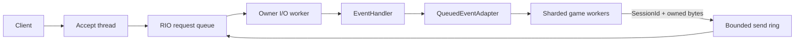

# 아키텍처

주 스레드가 Winsock, CQ와 세션 풀을 만든다. 각 세션은 한 I/O worker에 고정되고 `index+generation`이 수명을 식별한다. 세션 슬롯은 worker 파티션에 걸쳐 라운드로빈으로 대여하므로 기동 직후 부하가 한 worker에 몰리지 않는다. RIO 등록 버퍼는 완료가 끝날 때까지 주소와 등록 ID가 유지된다. 네트워크 callback에서 DB, 파일 I/O, room 처리를 실행하는 설계는 잘못이며 ChatServer처럼 유계 adapter로 넘기는 방식이 올바르다.

세션당 in-flight RIO 요청은 수신 1개와 송신 1개다. 송신은 애플리케이션이 쌓은 바이트를 double-mapped 링에 모으고, 진행 중인 요청이 완료되면 그때까지 쌓인 전체 구간을 하나의 `RIO_BUF`로 다시 게시한다. 따라서 완료 이벤트 수가 패킷 수가 아니라 burst 수에 비례하고 CQ 용량이 세션당 2개로 고정된다. 수신은 완료를 반영한 직후 콜백보다 먼저 다음 요청을 게시해 콜백 구간에도 수신이 진행되게 한다.

## 결정적 테스트 경계

`RioApi`와 `SocketApi`를 주입해 N번째 초기화 호출 실패와 롤백을 소켓 없이 재현한다. logger는 Server 인스턴스마다 주입하며 서로 다른 두 logger의 격리를 통합 테스트로 검증한다.

세션 재사용은 generation과 outstanding 요청 수로 결정한다. idle 검사와 peer-close drain은 production deadline을 사용하므로 transport 전체가 clock 독립적인 것은 아니다. application event adapter 역시 내부 작업자나 예약 실행기를 만들지 않고 `TryPop`으로 소비자가 직접 구동한다. 핵심 상태 전이와 큐 순서는 결정적 단위 검사로, 실제 deadline·RIO 완료·종료 경합은 OS 통합 검사로 확인한다.
