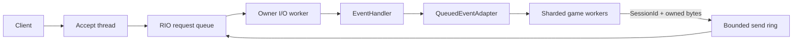
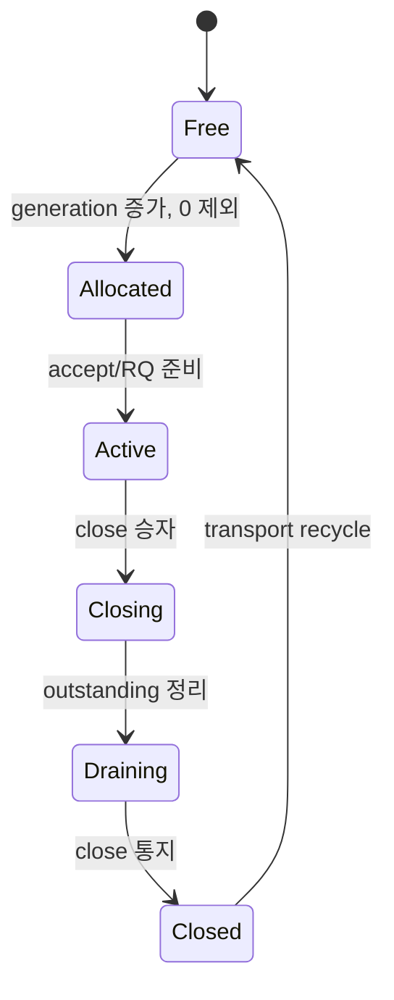

# 구조와 설계

주 스레드가 Winsock, CQ와 세션 풀을 만든다. 각 세션은 한 I/O worker에 고정되고 `index+generation`이 수명을 식별한다. 세션 슬롯은 worker 파티션에 걸쳐 라운드로빈으로 대여하므로 기동 직후 부하가 한 worker에 몰리지 않는다. RIO 등록 버퍼는 완료가 끝날 때까지 주소와 등록 ID가 유지된다. 네트워크 callback에서 DB, 파일 I/O, room 처리를 실행하는 설계는 잘못이며 ChatServer처럼 유계 adapter로 넘기는 방식이 올바르다.

세션당 in-flight RIO 요청은 수신 1개와 송신 1개다. 송신은 애플리케이션이 쌓은 바이트를 double-mapped 링에 모으고, 진행 중인 요청이 완료되면 그때까지 쌓인 전체 구간을 하나의 `RIO_BUF`로 다시 게시한다. 따라서 완료 이벤트 수가 패킷 수가 아니라 burst 수에 비례하고 CQ 용량이 세션당 2개로 고정된다. 수신은 완료를 반영한 직후 콜백보다 먼저 다음 요청을 게시해 콜백 구간에도 수신이 진행되게 한다.

## 결정적 테스트 경계

`RioApi`와 `SocketApi`를 주입해 N번째 초기화 호출 실패와 롤백을 소켓 없이 재현한다. logger는 Server 인스턴스마다 주입하며 서로 다른 두 logger의 격리를 통합 테스트로 검증한다.

세션 재사용은 generation과 outstanding 요청 수로 결정한다. idle 검사와 peer-close drain은 production deadline을 사용하므로 transport 전체가 clock 독립적인 것은 아니다. application event adapter 역시 내부 작업자나 예약 실행기를 만들지 않고 `TryPop`으로 소비자가 직접 구동한다. 핵심 상태 전이와 큐 순서는 결정적 단위 검사로, 실제 deadline·RIO 완료·종료 경합은 OS 통합 검사로 확인한다.

## 스레드와 콜백

accept 스레드는 OnConnected를 호출하고 I/O 워커는 자신의 세션 OnData/OnClosed를 처리한다. 같은 세션의 OnConnected가 끝난 뒤 다른 callback을 전달하며 수신과 종료 순서를 보존한다. 다른 세션과 Logger는 동시 실행될 수 있어 handler/logger의 공유 상태는 사용자가 동기화한다.

Send·RequestClose·Stop·Metrics는 여러 애플리케이션 스레드에서 호출할 수 있다. Stop은 실행 상태를 닫고 이미 진입한 transport 호출자를 배출한다. 객체 이동·파괴는 application 호출자 종료 후 수행한다. event/logger callback 안에서 같은 서버의 Start/Stop은 kInvalidState다. 종료가 필요하면 atomic flag나 control queue로 주 스레드에 알린다. callback에서 다른 스레드를 만들고 그 스레드의 Stop을 기다려도 join 교착이므로 기다리지 않는다.

callback에서 DB·파일·게임 로직을 수행하거나 span을 저장하지 않는다. QueuedEventAdapter가 owned raw bytes로 넘기고 게임 워커가 처리한다. adapter는 유계 저장소와 짧은 mutex를 사용한다. capacity 확보 실패 시 생산자를 무한 대기시키지는 않지만 mutex 경합 대기는 존재한다.

OnData 예외는 protocol close다. OnConnected/OnClosed와 Logger.Log 예외는 격리·기록 또는 무시한다. Logger.IsEnabled는 noexcept 계약을 지킨다. 커널은 별도의 비중첩 링 구간에 다음 수신을 게시하므로 callback span을 반환 전까지만 읽는다. 함수별 조건은 [API 계약](api/README.md#함수별-계약)에 있다.

## 세션 수명

index 7/generation 41이 닫힌 뒤 슬롯이 7/42로 재사용될 수 있다. 옛 게임 task에 index만 저장하면 새 사용자에게 송신·종료하게 된다. Send·RequestClose·I/O context·게임 이벤트에 전체 SessionId를 저장한다. uid 검사와 close 전이는 pool reserve/recycle과 같은 lock에서 보호한다.

transport 슬롯의 recycle은 outstanding와 close 통지를 기준으로 하며 게임 이벤트 소비까지 기다리지 않는다. adapter는 별도 gate에서 이전 generation의 parked close가 전달되기 전 새 connected를 거절한다. 이것은 transport와 application event의 서로 다른 수명이다. 게임 워커도 Player.id 전체를 확인해야 한다.

같은 세션의 OnConnected/OnClosed 순서를 보존하고 OnClosed 이후 OnData는 없다. accept는 첫 recv 게시까지 슬롯 보호를 유지한다. close 요청은 한 승자만 전이하며 제어 mailbox의 중복은 합친다. idle_timeout_ms는 마지막 수신 기준 약 1초마다 검사하므로 정확한 밀리초 타이머가 아니다. peer FIN drain도 deadline을 사용한다.

## 플랫폼과 설계 결정

다음 표는 기존 ADR 0001~0005의 현행 결정을 통합한 것이다. 2026-08-26의 단계별 구현 계획과 오래된 기준선 원문은 Git 이력에서 확인한다. 현재 계약은 이 문서, [API](api/README.md), [운영](operations.md), [검증](verification.md)을 따른다.

| 결정 | 범위와 이유 |
|---|---|
| Windows x64 TCP/IPv4 서버 | Windows 10 1803+·11·Server 2019+가 대상이며 전체 OS 검증 완료를 뜻하지 않는다. double mapping과 RIO 의존성이 있어 x86/Win32·IPv6·TLS·UDP·클라이언트 transport·DLL ABI는 제공하지 않는다. |
| VS2026/v145와 정적 배포 | `/std:c++latest`·`/utf-8`, Release `/MD`·Debug `/MDd`다. 정적 라이브러리·공개 헤더·PDB·정확한 소스 snapshot을 함께 배포한다. |
| 명시적 초기화 실패 | RIO 함수 테이블을 얻지 못하면 일반 Winsock으로 자동 fallback하지 않는다. 구체적인 library/native 오류를 반환한다. |
| 세션별 등록 메모리 | double-mapped 링이 wrap 복사를 없애고 수명과 실패 rollback을 세션 단위로 격리한다. worker arena로 바꾸기 전에 시작 비용이 실제 병목인지 측정한다. |
| 유계 저장소와 명시적 배압 | 무제한 queue가 메모리 고갈·tail latency로 이어지지 않도록 Send 거절과 overload close를 구분한다. adapter는 짧은 mutex를 사용하므로 lock-free나 무대기 API로 소개하지 않는다. |
| 완료를 확인하는 종료 | graceful/immediate를 구분하며 완료 전에 등록 메모리를 해제하지 않는다. Stop 실패를 정상 서비스 재사용의 근거로 삼지 않는다. |
| 선택적 mimalloc | 최종 executable이 적용 여부를 결정하며 공개 ABI에 allocator 타입을 노출하지 않는다. 현재 기본 패키지는 사용하지 않는다. |
| 비교 가능한 성능 증거 | Release x64, 같은 장비·설정, 예열·측정·후처리 분리, 최소 5회 중앙값, correctness 오류 0이 기준이다. 한 번에 한 설정만 바꾼다. |
