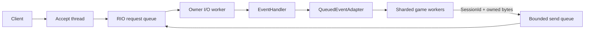

# 아키텍처

주 스레드가 Winsock, CQ와 세션 풀을 만든다. 각 세션은 한 I/O worker에 고정되고 `index+generation`이 수명을 식별한다. RIO 등록 버퍼는 완료가 끝날 때까지 주소와 등록 ID가 유지된다. 네트워크 callback에서 DB, 파일 I/O, room 처리를 실행하는 설계는 잘못이며 ChatServer처럼 유계 adapter로 넘기는 방식이 올바르다.

## 결정적 테스트 경계

`RioApi`와 `SocketApi`를 주입해 N번째 초기화 호출 실패와 롤백을 소켓 없이 재현한다. logger는 Server 인스턴스마다 주입하며 서로 다른 두 logger의 격리를 통합 테스트로 검증한다.

세션 재사용은 시간 경과가 아니라 generation과 outstanding 요청 수로 결정하므로 production clock 의존성이 없다. application event adapter 역시 내부 작업자나 예약 실행기를 만들지 않고 `TryPop`으로 소비자가 직접 구동한다. 따라서 fake clock과 deterministic executor가 필요했던 비결정적 경계를 설계에서 제거했으며, 상태 전이와 큐 순서는 호출 순서만으로 단위 테스트한다.
