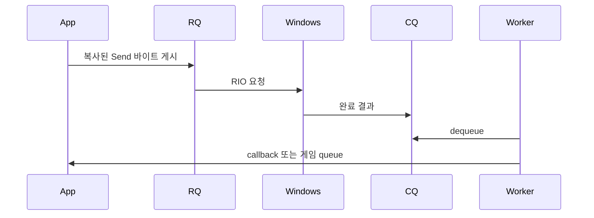

# 설치와 Echo 실습

RIONetLite 0.3.x는 Windows x64 TCP/IPv4 서버용 preview다. 0.x API와 ABI는 변경될 수 있다. 대상 OS는 Windows 10 1803 이상·Windows 11·Windows Server 2019 이상이며 전체 OS 조합에서 검증됐다는 뜻은 아니다. IPv6·TLS·UDP·클라이언트 transport API는 제공하지 않는다.

## 설치와 첫 왕복

1. Visual Studio Installer에서 Visual Studio 2026의 **Desktop development with C++**, MSVC v145, Windows SDK를 설치한다. ASan에는 C++ AddressSanitizer 구성 요소도 필요하다.
2. Git과 vcpkg를 준비하고 vcpkg의 MSBuild 통합을 설정한다. 루트 `vcpkg.json`의 manifest 복원은 GoogleTest와 mimalloc을 받는다. 최초 복원에는 네트워크와 추가 시간이 필요하다.
3. Developer PowerShell에서 저장소 루트로 이동한다.

```powershell
git clone --branch main https://github.com/jacking75/RIONetLite.git
cd RIONetLite
tools\build.ps1 -Configuration Debug -Rebuild
```

빌드 종료 코드 0과 두 테스트 suite의 `[ PASSED ]`를 확인한다. Release에서는 Debug allocation hook 검사 한 개가 skip될 수 있다. skip을 pass 개수에 합치지 않는다. `RIONetLite.sln`의 `Debug|x64`로도 빌드할 수 있지만 테스트 실행은 위 스크립트로 확인한다.

첫 번째 터미널에서 실행한다.

```powershell
bin\x64\Debug\EchoServer.exe --port 32452
```

`EchoServer listening on port 32452. Type quit or press Ctrl+C to stop.`이 나오면 두 번째 터미널도 루트에서 실행한다.

```powershell
bin\x64\Debug\LoadClient.exe --port 32452 --connections 4 --duration 10 --scenario echo --json result.json
$LASTEXITCODE
Get-Content result.json
```

종료 코드 0, `connected=4`, `received_packets>0`, `connection_failures/data_errors/dropped_packets/timeouts=0`이면 실제 왕복에 성공한 것이다. 숫자는 실행마다 다르다. 서버에서 `quit`과 Enter 또는 Ctrl+C로 끝낸다. `stop failed` 없이 종료 코드가 0이어야 한다. 최초 설치·복원까지 5분 안에 끝난다는 보장은 없다.

포트 충돌은 `Get-NetTCPConnection -LocalPort 32452 -State Listen`으로 확인하고 두 프로그램을 같은 다른 포트로 실행한다. [문제 해결](operations.md#문제-해결)을 참고한다.

## TCP와 RIO 입문

TCP는 바이트 순서를 지키는 stream이다. Send 두 번이 OnData 두 번이라는 뜻은 아니다. 메시지 하나가 여러 callback으로 나뉘거나 여러 메시지가 합쳐질 수 있다. 길이 header로 경계를 찾는 약속이 framing이다.

| 용어 | 의미 |
|---|---|
| RIO | 미리 등록한 메모리로 Windows 네트워크 요청을 처리하는 API다. |
| RQ | 연결별 request queue다. 수신·송신을 게시한다. |
| CQ | 끝난 요청 결과를 소유 I/O 워커가 꺼내는 completion queue다. |
| outstanding | 게시했으나 완료 정리가 끝나지 않은 요청 수다. |
| registered buffer | outstanding 동안 이동·해제하면 안 되는 등록 메모리다. |
| span | 소유권 없는 범위 보기다. callback 반환 뒤 사용할 수 없다. |
| generation | 같은 슬롯의 이전 연결과 현재 연결을 구별한다. |
| backpressure | 처리량 초과 작업을 유한한 저장량에서 거절·종료하는 제어다. |
| shard | 상태를 나눠 특정 게임 워커가 소유하는 단위다. |
| RAII | 객체 수명으로 자원을 관리하는 방식이다. |
| expected | 성공 값 또는 Error를 담는다. 실패 여부부터 확인한다. |



송신 수락·RIO 완료·상대 수신·상대 게임 처리는 서로 다른 시점이다. 상대 처리를 확인하려면 애플리케이션 ACK를 만든다. RIO가 DB나 게임 로직을 대신 병렬화하지는 않는다.

## 패킷 프레이밍

Echo의 LengthPrefixedDecoder는 big-endian u32 **header를 포함한 전체 길이**를 읽는다. ping 4바이트의 전체 길이는 8이다.

```text
00 00 00 08 | 70 69 6E 67
전체 길이 8 | p  i  n  g
```

| callback span | 소비량 | 결과 |
|---|---:|---|
| `00 00` | 0 | header 미완성이다. |
| `00 00 00 08 70` | 0 | 이전 미소비 바이트도 포함하며 body 미완성이다. |
| `00 00 00 08 70 69 6E 67` | 8 | 메시지 하나다. |
| 위 8바이트 두 개 | 16 | 메시지 두 개다. |
| 위 8바이트 뒤 다음 header 2바이트 | 8 | 미완성 header는 남긴다. |

decoder는 자체 누적 버퍼가 없다. OnData의 미소비 바이트는 transport가 다음 callback에 다시 포함한다. 애플리케이션이 또 누적하면 중복 처리된다. adapter는 raw 바이트를 모두 복사·소비하므로 게임 워커가 자기 누적 버퍼에서 framing한다. 두 누적 위치를 혼동하지 않는다.

길이 0~3은 kInvalidLength, maximum 초과는 kMessageTooLarge, 범위 안의 미완성은 정상 대기다. 오류 시 RequestClose(session, kProtocolError)를 요청한다. span보다 많은 소비량을 반환하면 연결이 닫힌다. decoder handler 예외는 전파되므로 네트워크 callback 경계에서 해당 세션을 닫는다.

Send(session, header, payload)는 두 span을 하나로 수락하고 복사한다. 전체 크기는 max_message_bytes 이하이어야 한다. header·byte order·version은 애플리케이션이 만든다. C#은 BinaryPrimitives의 BigEndian 함수를 사용한다. [Chat 명세](samples/chat-server.md#wire-protocol-v1)의 fixture로 양쪽을 확인한다. LoadClient의 split/coalesce 시나리오로 실제 TCP를 검사한다.

## Echo 코드 읽기

[EchoServer 전체 코드](../samples/echo_server/main.cpp)가 빌드되는 한 파일 예제다. 복사한 부분 코드 대신 이 파일을 열고 [첫 실행](getting-started.md)을 완료한다. README의 C++ 블록은 즉시 종료하는 package smoke 예제이므로 계속 대기하는 서버와 구별한다.

1. `EchoHandler`는 공개 EventHandler를 구현한다. `LengthPrefixedDecoder`의 maximum은 header를 포함한 전체 메시지 크기다.
2. main은 logger와 handler를 먼저 만들고 Server를 나중에 만든다. 역순 파괴 시 handler/logger가 Server보다 오래 산다. Create는 bind와 버퍼 확보를 수행하며 실패 시 Error를 확인한다.
3. `handler.Attach(*server)`는 callback이 Send/RequestClose를 호출할 대상을 연결한다. Start 전에 붙인다. 이 포인터의 수명은 main의 Server 수명 안이다.
4. OnData는 완성된 프레임마다 Send한다. kQueued는 복사·수락이다. kWouldBlock이면 무한 retry하지 않고 overload close를 요청한다. decoder 오류는 protocol close다. 반환값은 DecodeResult.consumed_bytes라 미완성 바이트가 transport에 남는다.
5. main은 quit·Ctrl+C·duration·stop-file을 기다린다. callback에서 Stop을 부르지 않는다. 종료 신호를 주 스레드가 받아 Stop(kGraceful)의 결과를 확인한다.

```text
handler/logger 생성 → Create → Attach → Start
  → OnData에서 decode와 빠른 Send
  → 주 스레드 종료 신호 → Stop 결과 확인 → Server 파괴 → handler/logger 파괴
```

실험은 `LoadClient --scenario split`, `coalesce`, `half-close` 순서로 수행한다. 각 실행의 JSON에서 오류와 누락이 0인지 확인한다. frame 길이를 잘못 만들면 protocol 종료가 정상 결과다. [프레이밍](getting-started.md#패킷-프레이밍)은 실제 소비량을, [API 계약](api/README.md#함수별-계약)은 실패별 동작을 설명한다.

이 예제는 최소 네트워크 사용을 보여준다. 룸·DB·파일 처리는 callback에 추가하지 않고 [게임 워커](samples/chat-server.md#게임-워커-구조)로 넘긴다.

## Echo 명령행

| CLI | 기본값·의미 |
|---|---|
| --port | 32452다. |
| --duration | 0, 무기한이다. 양수면 지정 초 뒤 종료한다. |
| --workers | CPU 기반 I/O 워커 수다. |
| --max-sessions | 1024다. 워커 수 이상이어야 한다. |
| --batch | 64다. |
| --spin | 128이다. |
| --wait-mode | adaptive, polling/notification도 가능하다. |
| --affinity | off다. |
| --observability | on, off는 Logger와 Server metrics를 끈다. |
| --stop-file | 해당 파일이 생기면 종료한다. |

LoadClient echo/split/coalesce의 JSON에서 연결 실패·data error·dropped packet·timeout 모두 0을 확인한다. quit 또는 Ctrl+C는 주 스레드에서 graceful Stop을 수행한다. 정상 종료는 exit 0이다. Send 배압은 overload close로 처리한다.

## 다음 단계

게임 처리와 Chat protocol은 [Chat 실습](samples/chat-server.md), 함수별 조건은 [API 레퍼런스](api/README.md), 자원과 스레드는 [구조](architecture.md), 설정·종료·오류 대응은 [운영](operations.md)을 따른다. ZIP 소비는 [패키지 안내](package-consumption.md)를 참고한다.
