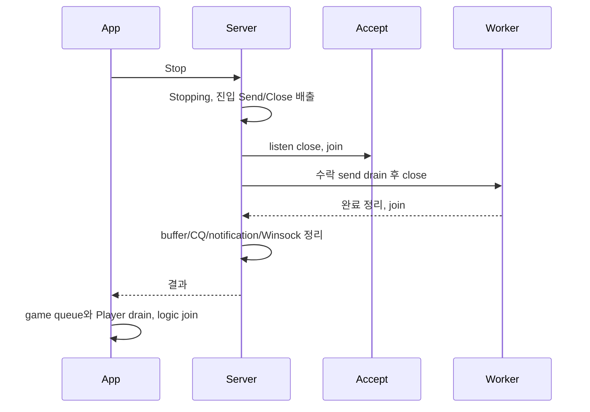

# 정상 종료

주 스레드에서 Stop(kGraceful)을 호출한다. 같은 서버의 event/logger callback에서 호출하면 kInvalidState다. callback은 종료 요청 flag만 전달하고 주 스레드가 Stop한다. 객체 이동·파괴는 모든 application 호출자가 종료된 뒤 수행한다.

graceful_shutdown_timeout_ms는 Stop 진입 이후 API 배출·accept join·송신 drain·I/O 종료가 공유하는 예산이다. immediate는 수락 송신 대기를 생략하지만 취소 완료는 정리한다. 동시·반복 Stop은 같은 결과를 받는다. 늦게 시작한 호출이 예산을 새로 늘리지 않는다.

이 값은 사용자 callback을 강제 중단하는 wall-clock 보장이 아니다. C++ join은 실행 중 callback을 중단할 수 없으므로 callback이 영구 대기하면 Stop도 기다린다. 시간 초과 뒤 안전 회수를 위한 최대 500ms 추가 drain이 있다. timeout을 정상 종료로 취급하지 않는다.

timeout에는 socket을 abort하고 취소 완료를 다시 꺼낸다. 여전히 outstanding이면 커널이 쓸 수 있는 buffer·mapping·CQ 소유권을 의도적으로 포기해 조기 해제를 막는다. 이 실패 상태에서는 프로세스를 정상 서비스로 재사용하지 않는다. Error.message의 remaining_outstanding/remaining_active_sessions와 로그를 보존한다. CQ corrupt도 실패다.

Stop은 transport만 끝낸다. adapter의 parked close를 포함한 depth, broadcast inbox, 실행 중 game task와 Player를 별도로 배출해야 한다. Chat은 마지막 `Logic drain: active_players=0 queued_events=0 pending_broadcasts=0`과 exit 0을 확인한다. peer_close_drain_timeout_ms는 FIN 뒤 수락 송신을 기다리는 별도 연결 예산이다.
