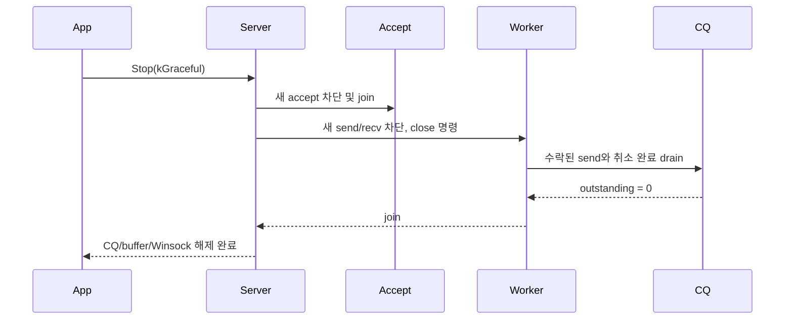

# 정상 종료

graceful은 timeout까지 수락된 send를 drain하고 immediate는 새 게시를 막고 취소 완료만 drain한다. `Stop`은 동시 호출해도 같은 종료를 기다린다. callback이나 등록 버퍼보다 CQ를 먼저 없애는 순서는 잘못이다.

worker가 timeout 안에 drain하지 못하면 소켓을 먼저 모두 닫아 커널이 미완료 요청을 취소하게 하고, 취소 완료를 종료 스레드에서 짧게 다시 drain한다. 그래도 outstanding이 남으면 등록 버퍼, 이중 매핑과 CQ를 해제하지 않고 소유권만 포기해 의도적으로 누수시킨다. 커널이 참조할 수 있는 메모리를 회수하는 것보다 누수가 안전하기 때문이다. 이 경우 `Stop`은 `kShutdownTimedOut`과 함께 `remaining_outstanding`을 보고하므로, 이 값이 0이 아닌 종료는 정상으로 취급하면 안 된다.

peer가 FIN 직후 사라져 미완료 송신이 완료되지 않으면 세션이 drain 상태로 남는다. `peer_close_drain_timeout_ms`를 넘기면 abortive close로 강등해 슬롯을 회수한다.
