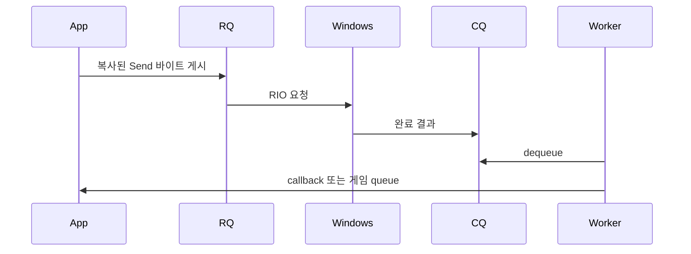

# TCP와 RIO 입문

TCP는 바이트 순서를 지키는 stream이다. Send 두 번이 OnData 두 번이라는 뜻은 아니다. 메시지 하나가 여러 callback으로 나뉘거나 여러 메시지가 합쳐질 수 있다. 길이 header로 경계를 찾는 약속이 framing이다.

| 용어 | 의미 |
|---|---|
| RIO | 미리 등록한 메모리로 Windows 네트워크 요청을 처리하는 API다. |
| RQ | 연결별 request queue다. 수신·송신을 게시한다. |
| CQ | 끝난 요청 결과를 소유 I/O 워커가 꺼내는 completion queue다. |
| outstanding | 게시했으나 완료 정리가 끝나지 않은 요청 수다. |
| registered buffer | outstanding 동안 이동·해제하면 안 되는 등록 메모리다. |
| span | 소유권 없는 범위 보기다. callback 반환 뒤 사용할 수 없다. |
| generation | 같은 슬롯의 이전 연결과 현재 연결을 구별한다. |
| backpressure | 처리량 초과 작업을 유한한 저장량에서 거절·종료하는 제어다. |
| shard | 상태를 나눠 특정 게임 워커가 소유하는 단위다. |
| RAII | 객체 수명으로 자원을 관리하는 방식이다. |
| expected | 성공 값 또는 Error를 담는다. 실패 여부부터 확인한다. |

송신 수락·RIO 완료·상대 수신·상대 게임 처리는 서로 다른 시점이다. 상대 처리를 확인하려면 애플리케이션 ACK를 만든다. RIO가 DB나 게임 로직을 대신 병렬화하지는 않는다. [프레이밍](packet-framing.md)과 [스레딩](threading-model.md)을 함께 읽는다.
