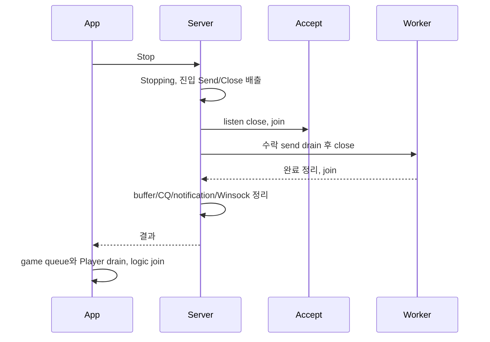

# 설정과 운영

[설치·Echo](getting-started.md) 이후 사용하는 설정, 배압, 종료, 로그와 오류 대응을 한곳에 모았다. 정확한 함수별 호출 조건은 [API 레퍼런스](api/README.md)를 따른다.

## 설정

| 설정 | 기본값 | 범위/단위 | 영향 |
|---|---:|---|---|
| `port` | 0 | 1..65535 | listen port, 0은 거부 |
| `io_worker_count` | CPU 기반 | 1..min(`max_sessions`, 256) | CQ/스레드 수 |
| `max_sessions` | 1024 | 1..INT32_MAX | 모든 메모리 예산에 선형 영향 |
| `max_receive_chunk_bytes` | 4096 | 1..recv buffer | RIO recv 길이 |
| `receive_buffer_bytes` | 64 KiB | page 배수, ≤1 GiB | 세션별 등록/매핑 |
| `max_message_bytes` | 16 KiB | 양쪽 buffer 이하 | 단일 Send/packet 제한 |
| `send_buffer_bytes` | 256 KiB | page 배수, ≤1 GiB | 유계 send 저장소이자 송신 배압 단위 |
| `completion_batch_size` | 64 | 1..4096 | 결과 배열과 batch |
| `worker_wait_mode` | adaptive | polling/adaptive/notification | 지연과 idle CPU |
| `adaptive_spin_count` | 128 | 0..1,000,000 | adaptive spin 비용 |
| `enable_thread_affinity` | false | bool | opt-in affinity |
| `enable_metrics` | true | bool | false이면 hot-path 카운터를 생략하고 `Metrics()`는 0 snapshot 반환 |
| `enable_callback_timing` | true | bool | false이면 콜백당 QPC 2회를 생략하고 `callback_*`만 0이 된다 |
| `graceful_shutdown_timeout_ms` | 5000 | 1..300000 ms | drain 상한 |
| `peer_close_drain_timeout_ms` | 5000 | 1..60000 ms | peer FIN 후 송신 drain 상한 |
| `idle_timeout_ms` | 0 | 0 또는 ≥1000 ms | 0이면 사용 안 함, 무통신 세션 종료 |
| `keepalive_time_ms` | 0 | 0이면 사용 안 함 | TCP keepalive 시작 시점 |
| `keepalive_interval_ms` | 1000 | keepalive 사용 시 ≥1 | TCP keepalive 재시도 간격 |

`ValidateServerConfig`의 `estimated_*_bytes`가 등록, 예약 virtual, commit, control 메모리를 시작 전에 분리 보고한다. page 정렬을 무시하는 설정은 잘못이다. 검증을 통과한 뒤에도 실제 자원 확보가 실패할 수 있으며, `Server::Create`는 이 경우 예외를 외부로 전파하지 않고 `kResourceAllocationFailed`를 반환한다.

### 송신 배압 단위

세션당 in-flight RIO 송신 요청은 1개로 고정된다. 애플리케이션이 보낸 바이트는 세션 송신 링에 쌓이고, 진행 중인 요청이 완료되면 그때까지 쌓인 전체 구간이 하나의 `RIO_BUF`로 다시 게시된다. 따라서 배압은 요청 슬롯 수가 아니라 `send_buffer_bytes`에 남은 바이트로 판정하며, 링에 들어가지 못한 메시지만 `kWouldBlock`이 된다. 소형 패킷이 많은 게임 트래픽에서 완료 이벤트 수가 패킷 수가 아니라 burst 수에 비례하고, RIO completion queue 용량도 세션당 2개로 줄어든다.

### 죽은 연결 회수

`keepalive_time_ms`를 지정하면 세션 소켓에 `SIO_KEEPALIVE_VALS`를 설정한다. 사라진 피어의 미완료 수신이 오류로 완료되어 기존 오류 경로가 슬롯을 회수한다. `idle_timeout_ms`를 지정하면 각 I/O worker가 약 1초 주기로 자기 파티션의 세션만 훑어 마지막 수신 이후 경과 시간이 상한을 넘은 세션을 `kIdleTimeout`으로 닫는다. 두 설정은 독립이며 함께 사용할 수 있다.

### 구체적인 예산 예시

기본 1024세션에서 recv 64KiB + send 256KiB backing commit 추정은 320MiB다. double mapping의 virtual reserve와 등록 범위 추정은 640MiB다. 두 view가 같은 backing을 가리키므로 등록 범위 640MiB를 물리 메모리 640MiB로 해석하지 않는다. control·close mailbox·CQ·thread stack·adapter/broadcast·allocator/kernel 추가 비용은 별도다. estimated_control_bytes는 근사치이며 실제 sizeof 또는 process 총량 보장이 아니다.

max_receive_chunk_bytes는 요청당 raw 수신 크기이고 max_message_bytes는 메시지/Send 제한이다. 여러 메시지의 합계 raw span이 message 제한보다 클 수 있다. adapter는 raw span을 조각으로 복사하고 게임 워커가 framing한다. 2 shard×1024 slot×1024 byte의 payload만 2MiB이며 gate와 parked index가 추가된다.

처음에는 기본 adaptive 정책을 사용하고 실제 workload의 P99·CPU·배압을 측정한 뒤 한 항목씩 바꾼다. keepalive 설정 실패는 접속 setup 실패 로그로 남기며 조용히 무시하지 않는다. shutdown timeout은 [종료 계약](operations.md#정상-종료)의 사용자 callback·추가 drain 한계를 따른다.

## 배압과 유계 저장소

Send 링은 세션당 send_buffer_bytes다. 공간 부족이면 kWouldBlock이며 수락하지 않은 메시지는 호출자가 소유한다. 게임 워커에서 상한 있는 retry queue, rate limit 또는 kOverloaded close를 선택한다. callback 안의 무한 retry는 완료를 처리할 워커를 막는다.

adapter는 shard별 events_per_shard slot과 slot별 max_payload_bytes를 기동 시 확보한다. raw OnData는 조각으로 나누므로 큰 TCP coalesce를 큰 메시지로 오판하지 않는다. 조각 자체는 메시지가 아니므로 게임 워커에서 framing한다.

| 정책 | 포화 동작 |
|---|---|
| kDisconnect | 거절된 chunk가 생기면 CloseRequest를 호출하고 입력은 소비한다. framed TCP에 사용한다. |
| kRejectNewest | 거절된 raw chunk를 소비·폐기하는 손실 정책이다. 뒤 바이트의 framing을 깨뜨릴 수 있어 framed TCP에 사용하지 않는다. |

close는 폐기하지 않는다. 링 포화 시 세션별 사전 확보 gate에 parked close를 저장하고 선행 이벤트를 소비한 뒤 전달한다. 해당 index의 새 generation connected는 이전 close가 전달될 때까지 거절한다. event_queue_depth는 링과 parked close를 모두 포함하므로 events capacity보다 클 수 있다. 이 보호가 애플리케이션 Player 상태를 자동 정리한다는 뜻은 아니다.

transport close 제어는 세션당 mailbox 하나와 worker당 최대 64개 batch다. 중복 close를 합치고 아직 outstanding인 세션은 다시 보류한다. Chat broadcast inbox도 shard당 1024개로 유계이며 모든 shard에 넣을 공간이 없으면 발신자를 overload close한다.

adapter.metrics의 depth/high_watermark/rejections와 Server.Metrics의 send_would_block을 따로 관찰한다. EstimatedMemoryBytes는 slot payload·gate·parked index 등의 추정이며 allocator·mutex·thread stack·kernel 비용은 process 계측으로 확인한다.

## 정상 종료

주 스레드에서 Stop(kGraceful)을 호출한다. 같은 서버의 event/logger callback에서 호출하면 kInvalidState다. callback은 종료 요청 flag만 전달하고 주 스레드가 Stop한다. 객체 이동·파괴는 모든 application 호출자가 종료된 뒤 수행한다.

graceful_shutdown_timeout_ms는 Stop 진입 이후 API 배출·accept join·송신 drain·I/O 종료가 공유하는 예산이다. immediate는 수락 송신 대기를 생략하지만 취소 완료는 정리한다. 동시·반복 Stop은 같은 결과를 받는다. 늦게 시작한 호출이 예산을 새로 늘리지 않는다.

이 값은 사용자 callback을 강제 중단하는 wall-clock 보장이 아니다. C++ join은 실행 중 callback을 중단할 수 없으므로 callback이 영구 대기하면 Stop도 기다린다. 시간 초과 뒤 안전 회수를 위한 최대 500ms 추가 drain이 있다. timeout을 정상 종료로 취급하지 않는다.

timeout에는 socket을 abort하고 취소 완료를 다시 꺼낸다. 여전히 outstanding이면 커널이 쓸 수 있는 buffer·mapping·CQ 소유권을 의도적으로 포기해 조기 해제를 막는다. 이 실패 상태에서는 프로세스를 정상 서비스로 재사용하지 않는다. Error.message의 remaining_outstanding/remaining_active_sessions와 로그를 보존한다. CQ corrupt도 실패다.

Stop은 transport만 끝낸다. adapter의 parked close를 포함한 depth, broadcast inbox, 실행 중 game task와 Player를 별도로 배출해야 한다. Chat은 마지막 `Logic drain: active_players=0 queued_events=0 pending_broadcasts=0`과 exit 0을 확인한다. peer_close_drain_timeout_ms는 FIN 뒤 수락 송신을 기다리는 별도 연결 예산이다.

## 로그와 지표

Logger.Log(LogEvent)는 timestamp(ns), level, component, worker, SessionId, operation, library/native error를 전달한다. callback/accept/lifecycle 등에서 동시 호출할 수 있다. string_view는 Log 동안만 유효하므로 비동기 logger queue에 저장하려면 복사한다. Log 예외는 격리한다. IsEnabled는 noexcept이고 짧게 반환한다. 파일 I/O는 별도 logging worker로 넘긴다.

| 지표 | 의미 |
|---|---|
| accepted/closed_connections | 누적 연결·종료 수다. |
| active_connections | 현재 활성 연결 gauge다. |
| received_bytes | 수신 완료로 들어온 누적 바이트다. |
| queued_send_bytes | kQueued로 수락한 누적 바이트다. 대기 queue gauge가 아니다. |
| sent_bytes | 성공한 RIO send completion의 누적 바이트다. 상대 ACK가 아니다. |
| send_operations | 수락한 Send 호출 수다. RIO 게시·완료 수와 다르다. |
| send_would_block/stale_operations/protocol_errors | 배압·오래된 ID·protocol 실패 누적이다. |
| callback_* | count·total/max ns다. total/count로 평균을 구한다. |
| adapter event_queue_depth | 링과 parked close를 포함한 현재 gauge다. |
| adapter high_watermark/rejections/dequeued/wait_* | 최고 저장량·거절·소비 수와 total/max 대기 ns다. |

Server.Metrics와 adapter.metrics는 별도 snapshot이다. Server의 event_queue 필드는 0이고 adapter가 제공한다. 여러 atomic을 합친 eventually consistent 조회이므로 순간 항등식으로 오류를 판정하지 않는다.

enable_metrics=false는 Server 지표를 0으로 반환한다. enable_callback_timing=false는 callback_*만 생략한다. adapter 계측은 별도로 유지된다. Echo --observability off는 Server metrics와 Logger를 끈다.

오류 조사 시 Error.code/native_code/field/message와 LogEvent.operation을 같이 남긴다. 예를 들어 bind_failed와 native 10048은 사용 중인 포트다. native 0은 플랫폼 원인이 제공되지 않은 오류일 수 있다. [문제 해결](operations.md#문제-해결)을 따른다. 성능 비교는 [검증 안내](verification.md#성능-측정)의 동일 장비·설정·correctness 조건을 따른다.

## 문제 해결

실패한 expected의 code/native_code/field/message와 실행 command·OS·compiler·source hash를 먼저 보존한다.

| 증상 | 확인·조치 | 재검증 |
|---|---|---|
| MSBuild/v145 없음 | VS2026 C++ workload와 v145 설치, Developer PowerShell을 확인한다. | tools/build.ps1 Debug와 Release다. |
| vcpkg 복원 실패 | root manifest와 MSBuild integration·네트워크·복원 오류를 확인한다. | 첫 실패 원인을 수정한 뒤 같은 빌드다. |
| bind_failed/native 10048 | Get-NetTCPConnection -LocalPort 32452 -State Listen으로 PID를 확인한다. 다른 프로세스를 무작정 종료하지 않고 다른 포트를 두 프로그램에 지정한다. | LoadClient echo다. |
| rio_unavailable | x64·대상 OS·Winsock provider와 native code를 확인한다. fallback transport는 없다. | 실제 integration 실행이다. |
| kWouldBlock 증가 | 소비 속도·send_buffer_bytes·queued_send_bytes와 sent_bytes를 확인한다. 무한 callback retry를 제거한다. | 같은 입력과 유계 retry/close 정책이다. |
| 정상 Chat 입력이 닫힘 | version/length/type/UTF-8 byte 수·close reason·event rejections를 확인한다. 기존 5바이트 클라이언트는 호환되지 않는다. | tools/test-chat.ps1의 split/coalesce·동일 room 검사다. |
| 다른 shard에 채팅 없음 | 모든 shard의 broadcast inbox 전달과 같은 room 설정을 확인한다. | 1/2/4 shard의 3명 이상 검사다. |
| stale session | index/generation 전체를 task에 저장한다. 이전 generation은 폐기한다. | slot 재사용 integration이다. |
| Stop 거절 | callback 안의 Stop을 제거하고 control thread에 flag를 보낸다. | callback reentry 검사다. |
| Stop timeout | outstanding·active·막힌 callback·game queue를 확인한다. 실패를 성공으로 감추지 않는다. | bounded callback과 같은 stop 모드에서 재실행한다. |
| 최초 workload 후 handle 증가 | RIO provider의 최초 worker 자원과 반복 추세를 구분한다. 같은 quiescent 상태를 비교한다. | 예열 포함 run-stress와 반복 Stop handle 회수다. |
| package link 실패 | manifest compiler/SDK/x64/MD, include/lib와 Ws2_32/OneCore를 확인한다. Release lib와 MDd를 섞지 않는다. | ZIP-only consumer rebuild다. |

public EventHandler에는 OnRejectedConnection callback이 없다. 거절 수는 rejected_connections 지표와 Logger로 확인한다. 기록 없는 오류를 임의 원인으로 단정하지 않는다. dump·payload 민감 정보는 [보안 경로](../SECURITY.md)로 전달한다.
