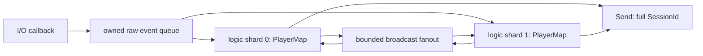

# ChatServer와 C# 클라이언트

게임 룸 처리와 PlayerMap은 별도 게임 워커가 소유한다. 네트워크 callback은 QueuedEventAdapter로 raw stream을 복사한다. 같은 room에 서로 다른 shard 사용자가 있어도 유계 broadcast inbox로 모두 전달한다. [게임 워커 설명](chat-server.md#게임-워커-구조)과 [프로토콜](chat-server.md#wire-protocol-v1)을 참고한다.

```powershell
tools\build.ps1 -Configuration Release -Rebuild
bin\x64\Release\ChatServer.exe --port 32453 --logic-workers 2 --io-workers 4 --max-sessions 32
dotnet build samples\chat_client\csharp_test_client.csproj -c Release
samples\chat_client\bin\Release\net10.0-windows\ChatClient.exe
```

클라이언트 빌드에는 .NET 10 SDK, 실행에는 .NET 10 Windows Desktop runtime이 필요하다. 현재 제공하는 WinForms 클라이언트는 8바이트 version 1 protocol을 사용한다. 옛 .NET 5/5바이트 packet 클라이언트와 호환되지 않는다.

1. 서버 listening 출력을 확인한다. 두 번째·세 번째 터미널에서 ChatClient.exe를 각각 실행한다.
2. 화면의 주소 127.0.0.1, 포트 32453, 서로 다른 이름, 방 1을 넣고 **연결·입장**을 누른다. 로그인·방 입장 성공이 표시돼야 한다.
3. 채팅 입력에 hi 또는 한글을 넣고 **채팅 전송**이나 Enter를 누른다. 같은 방의 두 창에 각각 한 번 표시돼야 한다.
4. **연결 종료** 후 한 창을 방 2로 다시 연결한다. 방 1 메시지가 방 2에 표시되면 실패다. 방 이동은 재접속으로 수행한다.
5. heartbeat는 연결 후 5초마다 자동 전송한다. 이름은 UTF-8 1..32바이트, 채팅은 0..256바이트다. 제한 초과는 UI 오류 메시지로 확인한다.
6. 서버에서 quit 또는 Ctrl+C로 종료한다. `Logic drain: active_players=0 queued_events=0 pending_broadcasts=0`과 exit 0을 확인한다.

| CLI | 기본값·의미 |
|---|---|
| --port | 32453이다. |
| --logic-workers | 2, 1..max-sessions다. |
| --io-workers | CPU 기반, 1..min(max-sessions,256)이다. |
| --max-sessions | 1024다. |
| --idle-seconds | 30, 게임 protocol activity 기준이다. |
| --duration | 생략하면 계속 실행한다. 지정할 때 양수 초다. |
| --stop-file | 지정 파일이 생기면 종료한다. |

```powershell
tools\test-chat.ps1 -Configuration Release
```

자동 검사는 같은 C# 송수신 코드를 사용해 1/2/4 logic shard 각각 같은 room 3명·다른 room·UTF-8 분할·2/4/16KiB heartbeat 병합·최대 payload·재접속·malformed close·정상 drain을 확인한다. stdout/JSON은 artifacts/chat에 남긴다. 이 결과는 GUI 버튼·창 배치의 수동 검사와 별도 PC 설치를 대신하지 않는다. 이 서버는 입문 예제이며 인증·영속성·복수 서버 room 분산은 제공하지 않는다.

## 게임 워커 구조

OnData의 span은 callback 동안만 유효하다. 게임 로직이 나중에 사용하려면 owned payload로 복사한다. QueuedEventAdapter는 연결·raw data·종료를 미리 확보한 shard별 저장소로 복사하며 `session.index % shard_count`로 라우팅한다. 세션 순서와 generation을 함께 유지한다.

[ChatApplication 전체 코드](../../samples/chat_server/main.cpp)를 다음 순서로 읽는다.

1. max_sessions와 일치하는 adapter session gate를 만들고 kDisconnect와 RequestClose lambda를 설정한다. 모든 차원은 양수이고 capacity는 유한하다.
2. Attach 후 게임 워커를 시작하고 Server를 Start한다. 네트워크 callback은 adapter 복사만 수행한다.
3. 각 RunShard는 재사용하는 destination 버퍼로 TryPop한다. Connected에서 Player를 만들고 Data에서 자신의 stream 누적 버퍼에 복사한다. 완성된 메시지의 login/join/chat 처리는 이 워커에서 수행한다.
4. Closed는 Player.id 전체가 이벤트의 SessionId와 같을 때만 지운다. index가 같아도 이전 generation의 이벤트는 새 Player를 지우지 못한다.
5. 방 채팅은 유계 broadcast inbox를 모든 게임 shard에 넣는다. 각 shard가 자기 PlayerMap에서 같은 room의 사용자를 골라 Send한다. 한 shard만 순회하면 다른 shard의 같은 방 사용자를 놓친다.
6. Server Stop이 모든 close를 만든 뒤 adapter depth·pending broadcast·실행 중 logic를 배출하고 게임 워커를 join한다. parked close도 depth에 포함된다. 마지막 active player 수가 0인지 확인한다.



TryPop의 kDestinationTooSmall은 이벤트를 제거하지 않는다. header.payload_bytes 이상 버퍼를 준비한 뒤 재시도한다. kEmpty는 현재 시점의 빈 snapshot이며 producer가 살아 있는 동안 전체 종료를 뜻하지 않는다. 어댑터는 짧은 mutex를 사용하므로 lock-free API라고 부르지 않는다. [배압](../operations.md#배압과-유계-저장소)에서 포화 정책을 결정한다.

## Wire protocol v1

모든 정수는 big-endian이다. 문자열은 strict UTF-8이고 길이는 문자 수가 아니라 byte 수다. 전체 frame은 8..1024바이트다. 아래 계약은 서버와 .NET 10 클라이언트의 공통 fixture로 검증한다.

| offset | 크기 | 값 |
|---:|---:|---|
| 0 | 4 | u32 전체 길이, header 포함이다. |
| 4 | 2 | u16 version=1이다. |
| 6 | 2 | u16 type이다. |
| 8 | 나머지 | payload다. |

| 요청 type | 상태 | payload | 응답 |
|---:|---|---|---|
| 1 login | Login | u16 이름 byte 길이 + UTF-8, 1..32 byte | 101, 빈 payload다. |
| 2 join | Lobby | u32 room 번호다. 0도 허용한다. | 102, 같은 room 번호다. |
| 3 chat | Room | u16 text byte 길이 + UTF-8, 0..256 byte | 같은 room의 모든 사용자에게 103, 동일 payload다. 발신자도 포함한다. |
| 4 heartbeat | 모든 상태 | 빈 payload다. | 응답은 없고 activity를 갱신한다. |

```text
login A: 00 00 00 0B 00 01 00 01 00 01 41
join 1:  00 00 00 0C 00 01 00 02 00 00 00 01
chat hi: 00 00 00 0C 00 01 00 03 00 02 68 69
beat:    00 00 00 08 00 01 00 04
```

잘못된 길이·version·type·상태·UTF-8은 protocol close다. 로그인은 이름 등록이며 비밀번호 인증이 아니다. room leave/list/password·메시지 저장·사용자 영속 ID는 없다. 다른 room으로 이동하려면 새 연결로 들어간다. 포화는 overload close를 사용한다.

[chat-fixtures.tsv](../protocol/chat-fixtures.tsv)는 8개 request/response의 golden hex다. C++ unit과 C# 실제 encoder/decoder가 동일 파일을 읽는다.

설정·포화·종료 계약은 [운영 안내](../operations.md), 자동 검사와 미검증 범위는 [검증 안내](../verification.md)를 따른다.
