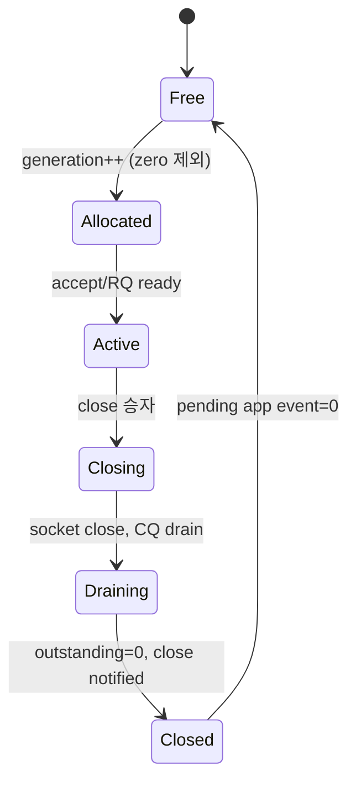

# 세션 수명

인덱스만 보관해 다음 연결에 송신하는 것은 잘못이다. 모든 send, close, I/O context와 app event에 전체 `SessionId`를 저장하고 현재 generation과 다르면 접근 없이 폐기해야 한다. 동일 수명에서 close 전이와 `OnClosed` 통지는 각각 한 번뿐이다.

`OnClosed` 이후에는 같은 세션의 `OnData`가 오지 않는다. 종료를 관찰한 뒤 커널이 이미 완료시킨 수신이 남아 있어도 콜백 없이 요청만 정리한다. 세션 슬롯은 worker 파티션에 걸쳐 라운드로빈으로 대여되므로, 기동 직후 첫 접속들도 특정 worker에 몰리지 않는다.

`idle_timeout_ms`를 설정하면 마지막 수신 이후 무통신 상태가 상한을 넘은 세션이 `kIdleTimeout`으로 닫힌다. 이는 정상 종료 경로와 동일하게 `OnClosed`를 한 번 통지한다.
