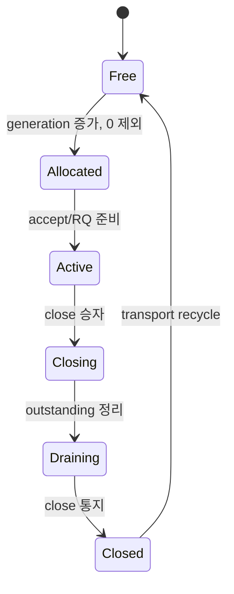

# 세션 수명

index 7/generation 41이 닫힌 뒤 슬롯이 7/42로 재사용될 수 있다. 옛 게임 task에 index만 저장하면 새 사용자에게 송신·종료하게 된다. Send·RequestClose·I/O context·게임 이벤트에 전체 SessionId를 저장한다. uid 검사와 close 전이는 pool reserve/recycle과 같은 lock에서 보호한다.

transport 슬롯의 recycle은 outstanding와 close 통지를 기준으로 하며 게임 이벤트 소비까지 기다리지 않는다. adapter는 별도 gate에서 이전 generation의 parked close가 전달되기 전 새 connected를 거절한다. 이것은 transport와 application event의 서로 다른 수명이다. 게임 워커도 Player.id 전체를 확인해야 한다.

같은 세션의 OnConnected/OnClosed 순서를 보존하고 OnClosed 이후 OnData는 없다. accept는 첫 recv 게시까지 슬롯 보호를 유지한다. close 요청은 한 승자만 전이하며 제어 mailbox의 중복은 합친다. idle_timeout_ms는 마지막 수신 기준 약 1초마다 검사하므로 정확한 밀리초 타이머가 아니다. peer FIN drain도 deadline을 사용한다.
