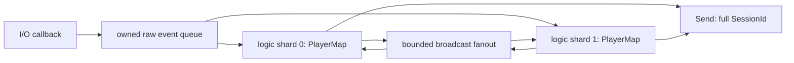

# 게임 워커로 넘기기

OnData의 span은 callback 동안만 유효하다. 게임 로직이 나중에 사용하려면 owned payload로 복사한다. QueuedEventAdapter는 연결·raw data·종료를 미리 확보한 shard별 저장소로 복사하며 `session.index % shard_count`로 라우팅한다. 세션 순서와 generation을 함께 유지한다.

[ChatApplication 전체 코드](../../samples/chat_server/main.cpp)를 다음 순서로 읽는다.

1. max_sessions와 일치하는 adapter session gate를 만들고 kDisconnect와 RequestClose lambda를 설정한다. 모든 차원은 양수이고 capacity는 유한하다.
2. Attach 후 게임 워커를 시작하고 Server를 Start한다. 네트워크 callback은 adapter 복사만 수행한다.
3. 각 RunShard는 재사용하는 destination 버퍼로 TryPop한다. Connected에서 Player를 만들고 Data에서 자신의 stream 누적 버퍼에 복사한다. 완성된 메시지의 login/join/chat 처리는 이 워커에서 수행한다.
4. Closed는 Player.id 전체가 이벤트의 SessionId와 같을 때만 지운다. index가 같아도 이전 generation의 이벤트는 새 Player를 지우지 못한다.
5. 방 채팅은 유계 broadcast inbox를 모든 게임 shard에 넣는다. 각 shard가 자기 PlayerMap에서 같은 room의 사용자를 골라 Send한다. 한 shard만 순회하면 다른 shard의 같은 방 사용자를 놓친다.
6. Server Stop이 모든 close를 만든 뒤 adapter depth·pending broadcast·실행 중 logic를 배출하고 게임 워커를 join한다. parked close도 depth에 포함된다. 마지막 active player 수가 0인지 확인한다.

TryPop의 kDestinationTooSmall은 이벤트를 제거하지 않는다. header.payload_bytes 이상 버퍼를 준비한 뒤 재시도한다. kEmpty는 현재 시점의 빈 snapshot이며 producer가 살아 있는 동안 전체 종료를 뜻하지 않는다. 어댑터는 짧은 mutex를 사용하므로 lock-free API라고 부르지 않는다. [배압](../backpressure.md)에서 포화 정책을 결정한다.
